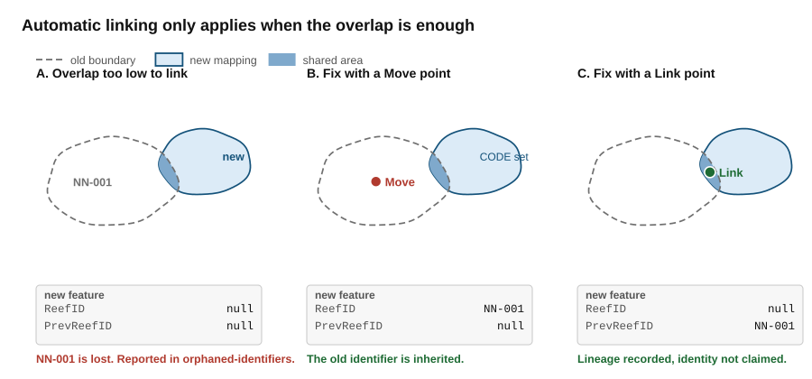
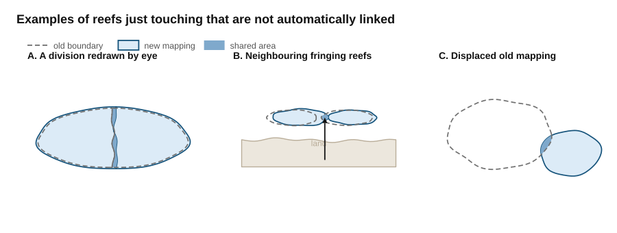

# Reviewing the reef identifier outputs

This guide explains the review layers written by `02a-patch-TS-GBR-Features.py`, what each one
tests, and what to do about the records it contains. It is written for someone returning to the
repository after a gap, so it repeats context that is obvious while the work is in progress.

The reasoning behind the method is in `02a-PrevReefID-problem.md` and `02a-PrevReefID-solution.md`.
The implementation is described in `02a-patch-TS-GBR-Features_design.md`. This document covers only
the review cycle.

## Why the layers exist

Stage 02a decides which newly mapped features inherit an official GBRMPA identifier. It does this
by measuring overlap between the old and new mapping and applying thresholds. The thresholds are
judgement values, so the method is expected to get some cases wrong. Rather than halting on
anything uncertain, which would prevent the pipeline running at all, the script records the
uncertain cases and continues.

Every layer is spatial, because deciding whether a relationship is real means looking at the
location against imagery. None of them can be resolved from a table. Records are removed from these
layers by correcting the input mapping, not by editing the layers, which are overwritten on every
run.

## Opening the layers

The file is `working/{version}/02/debug-reefid-review.gpkg`, written fresh on every run of
`02a-patch-TS-GBR-Features.py`. Drag it into QGIS and all layers load together. The coordinate
system is EPSG:4283, matching the dataset.

A layer with no records is not written at all, and the run output says so. An absent layer
therefore means the check passed, not that something failed. On the current input
`override-problems` is absent for this reason.

Load the input mapping alongside it. The old boundaries are in `working/{version}/01/TS-GBR-Features-latest.shp`,
the new mapping is `data/{version}/in/Reef-edit/AIMS_GBR-TS-Features_Edit_{version}.shp`, and the
control points are `data/{version}/in/Reef-remove-move/AIMS_GBR-TS-Features_remove-move_{version}.shp`.
Most decisions need all three plus the underlying imagery.

## How issues are resolved

Almost every problem is fixed by adding a point to the Reef Remove-Move layer, or by setting the
`CODE` attribute on a new polygon. Editing effort was kept to placing a point precisely so that the
record stays visual and no identifier has to be typed or maintained on both layers.

| `ACTION` | Placement | Effect |
|---|---|---|
| `Move` | On the old feature | Deletes the old feature. The replacement polygon must carry its `CODE`, which forces the relationship regardless of geometry |
| `Remove` | On the old feature | Deletes the old feature with no successor. Use where the feature was mapped in error |
| `Link` | Where a new and an old polygon overlap | Forces a relationship that can only ever produce a previous identifier. The feature never inherits the official identifier through a `Link` |

Any other `ACTION` value halts the run. This is deliberate, so that a value the code does not yet
support cannot be silently ignored.

Setting `CODE` on a new polygon is the alternative to a `Move` point where the old feature is
displaced far enough that no overlap remains. Several new polygons may carry the same `CODE`, which
records that they all derive from one old feature.

Keep `Link` points clear of rocks and cays nested inside reefs. A point inside one of those
can select the wrong old feature.

## orphaned-identifiers

Old features that were deleted and whose official identifier appears nowhere in the output, in
neither `ReefID` nor `PrevReefID`. Geometry is the old boundary.

| Field | Meaning |
|---|---|
| `ReefID` | The lost official identifier |
| `CODE` | The old feature's source code |
| `area_km2` | Area of the old feature |
| `max_share` | The best overlap found on this old feature, as a fraction of the smaller polygon. Null where the feature was deleted by a point rather than by an overlap |
| `reason` | Why the old feature was deleted |

This is the most important layer, because every record is a GBRMPA identifier that the dataset has
dropped. Deletion and lineage are decided independently, so an old boundary can be superseded by
new mapping without the new feature ever qualifying as related to it. That is how identifiers go
missing without anything obviously failing.

Split the layer on `reason` before reviewing it. There are three values and they need different
treatment.

| `reason` | What happened | What to do |
|---|---|---|
| `Remove point` | A deliberate deletion through a `Remove` point | Check the removal was intended. Normally nothing further |
| `Overlap below threshold 0.10` | New mapping covered the old boundary, but the best overlap was too small a share of either polygon to establish a relationship | Decide whether the overlap is a real succession, and add a `Move` or `Link` point if it is |
| `Overlap rejected as sliver` | The overlap was a thin edge contact and was discarded before the share test | Usually correct. Check `max_share`, since a high value on a small feature means something the sliver test could not judge |

Sort within each group by `area_km2` descending, since a lost identifier on a large reef costs
more than one on a rock. `max_share` tells you how close the case was before you open the imagery.
A value near the threshold is an arguable call, and a value near zero is a genuine near-miss that
probably needs a `Move` point rather than a `Link`.

Records with `reason = 'Overlap rejected as sliver'` and a high `max_share` deserve a second look.
The erosion test is capped at a quarter of the smaller feature's width precisely so that small
features are not erased by it, but a rock lying along the edge of a new reef can still be rejected
correctly. `20-814` is the pattern to expect: a rock with a sliver contact against a neighbouring
reef and no matching feature in the new mapping, which is an omission in the new mapping rather
than a fault in the test.

To resolve a record, find the new feature covering the old boundary and decide what it represents.
If it is the replacement for the old reef, add a `Move` point and set the old `CODE` on it. If it
is a different feature that happens to cover part of the old boundary, add a `Link` point so that
the identifier is recorded as previous. If the old feature was mapped in error and there is no
successor, add a `Remove` point, which moves the record into the other category and documents the
decision.

The layer should eventually contain only deliberate removals. It is the closest of these checks to
being worth halting on, and it could be made a blocking check once the list is stable.

**Figure 1.** Automatic linking and explicit corrections. Panel A qualifies because the shared
area is at least ten per cent of either polygon; both shares need not pass. Automatic overlaps
must also survive the sliver test. In panel B both shares are too low, so the old reef is deleted
without its identifier passing on. Panels C and E show a `Move` point on the old reef with its
`CODE` set on the replacement, with weak overlap and no overlap respectively. Panel D illustrates
the `15-004a/b/c` merge. The dominant overlap supplies `ReefID = 15-004b`, while `15-004c`
qualifies automatically as `PrevReefID`. A `Link` point inside the weak overlap adds `15-004a`
to `PrevReefID`, shown in green, without changing `ReefID`. Its bars measure the overlap with
`15-004a`. Panel F shows deliberate removal without a successor. Boundaries are schematic;
the other inheritance examples assume one old identifier and one successor.

## sub-threshold-overlaps

Intersecting pairs that survived the sliver test but failed the candidate share test, so no
relationship was recorded. Geometry is the intersection, which is often several disjoint pieces.

| Field | Meaning |
|---|---|
| `ReefID`, `CODE` | The old feature |
| `area_old_km2`, `area_new_km2` | Areas of the two polygons |
| `area_int_km2` | Area of the intersection |
| `share_old`, `share_new` | Intersection as a fraction of each polygon |
| `sole_pair` | True where the old feature has no other candidate relationship |

Most records here are correct rejections. Neighbouring reefs touch because of positional error in
the old mapping or because an internal division was redrawn by eye, and recording those contacts as
lineage would associate unrelated reefs. The layer exists so that the rejections can be checked
rather than assumed.

**Figure 2.** The three situations these records come from. Both shares are below 0.1 in every
case, so no reef identifier is carried across automatically. In panel A a large reef mapped in two
parts has had its internal division redrawn by eye, and on a reef this large the offset is too
wide to be caught by the sliver test. In panel B two neighbouring fringing reefs have been remapped
in more detail and the left one now wanders slightly into its neighbour, arrowed. Neither case
needs any action, because the two halves of one reef are not related to each other and adjacent
reefs are not a lineage relationship. Panel C is the case the review exists to catch: the old
mapping is displaced, so the feature that really replaces it barely reaches it. That one needs a
`Move` point if it is the replacement, or a `Link` if it only covers part of the old reef.

Two things are worth looking at. Records with `sole_pair = True` are the most likely to be a real
one to one replacement that the threshold missed, because the old feature has no other claimant.
Records whose `ReefID` also appears in `orphaned-identifiers` are the specific pairs whose rejection
cost an identifier, and reviewing the layer from that direction is far quicker than working through
every record.

The shares tell you which fix applies without opening the imagery. A low `share_old` with a high
`share_new` is a fragment of a larger old reef, which usually wants a `Link`. A high `share_old`
with a low `share_new` is an old reef absorbed into a much larger new feature, which also wants a
`Link`. Both shares being very small is a boundary contact, which usually wants nothing.

This layer is also the evidence for whether `CANDIDATE_SHARE`, currently 0.1, is set correctly. If
review shows that a consistent band of records just below the threshold are all real, the threshold
is too high. Change the threshold only after the individual cases have been worked through, since
lowering it also admits every incidental contact in that band.

## extreme-size-changes

Relationships where an identifier was inherited but the new feature's area differs from the old by
more than `SIZE_CHANGE_REPORT`, currently a factor of five. Geometry is the new feature.

| Field | Meaning |
|---|---|
| `ReefID` | The inherited official identifier |
| `area_old_km2`, `area_new_km2` | Areas before and after |
| `area_ratio` | Ratio between them |

The method treats an identifier as naming a reef rather than a shape, so a large change in area
does not by itself break the identity. Much of the old mapping was poor, and correcting it produces
large ratios legitimately. This layer tests that assumption rather than reporting an error, and a
long list is not in itself a problem.

What to look for is a change large enough that the new feature is plainly not the same reef. That
happens where an old polygon covered two reefs that were always distinct and the new mapping
separates them unevenly, so the larger piece takes an identifier that has an equal claim from the
smaller. Resolving one of these needs a judgement about which piece should hold the identity, and
until `ACTION='ReefID'` is implemented there is no way to record that decision other than to note
it for GBRMPA.

Old mapping frequently extended across land where the new mapping does not, which inflates the
ratio without meaning anything. Whether to clip both against the coastline before computing the
ratio is an open question recorded in the solution document.

Only relationships that actually resulted in inheritance appear here. An earlier version also
listed features that went on to win a second identifier and therefore took none, which swamped the
layer.

## override-problems

Control points that no longer do what they were placed to do. Geometry is the point. The layer is
absent when there are none, which is the current state.

An override records a decision made against the mapping as it stood at the time. The mapping keeps
changing, so a point can become wrong without anything visible happening. Each point is rechecked on
every run.

A point is reported as obsolete where it no longer resolves, meaning it falls outside the features
it referred to, or the pair it identified no longer intersects. This is the case where a boundary
has since been redrawn. A point is reported as unnecessary where the outcome would now be the same
without it, for example a `Link` on a pair that now passes the candidate test on its own, or a
`Link` that duplicates an existing move.

Unnecessary points are not errors, but they should be deleted so that the remaining points read as a
short list of live decisions rather than an accumulating record of past ones. Obsolete points should
be repositioned or deleted, since leaving them means a stale decision is being applied.

## inshore-gaps

Old features that survive into the output but lie within the inshore area that was nominally
remapped. Geometry is the old feature.

| Field | Meaning |
|---|---|
| `ReefID`, `CODE` | The old feature |
| `FEAT_NAME` | Its type in the source mapping |
| `area_km2` | Area of the old feature |

This measures how complete the inshore remapping is rather than testing the identifier logic. A
record means old mapping was left in place inside an area that was meant to be redone. The extent
is defined by `data/{version}/extras/inshore-extent/inshore-extent.shp`.

Review by `FEAT_NAME` and by area. Reef records are the ones to work down. Rock records are largely
features that were not remapped by intent, and whether to filter them out of this report is an open
question. Keeping them means every remaining gap is an explicit decision rather than an omission,
which is the current preference.

A record is resolved either by remapping the feature, which deletes the old boundary through the
normal overlap rule, or by accepting the old boundary as adequate. There is currently no way to
record the second decision, so accepted gaps stay in the list.

## shared-reefid

Features in the output that hold an official identifier also held by another feature. Geometry is
the output feature, and the layer carries the full output attribute schema.

This was intended as a hard validation, on the assumption that an official identifier could only
ever appear once. That assumption is wrong. In the GBRMPA source a reef and the rock, island or cay
sitting on it commonly share one `LABEL_ID`, so 660 of 9,050 source rows share an identifier with
another row. Two retained features holding the same `ReefID` is therefore normal and expected, and
`reeffid_utils.py` gives them distinct `ReefFID` values by appending `-F01` and `-F02` suffixes.

Check that each group is a legitimate source pairing, which is usually obvious from `RB_Type_L3` and
the `CODES` values, one being a reef and the other a rock or cay at the same location. What this
layer is really guarding against is a future change to the allocation splitting an identifier
between two unrelated features. If a group contains two features that are not the same location, the
allocation logic has broken.

## Suggested order of work

Start with `orphaned-identifiers` filtered to `reason = 'Overlap below threshold 0.10'`, sorted by
area. These are the only records where the output is definitely wrong rather than possibly
conservative, and each one is a lost official identifier.

Use `sub-threshold-overlaps` as a lookup while doing that, matching on `ReefID`, rather than
reviewing it end to end. An orphan with no matching record there had its overlap rejected as a
sliver or had no intersection at all, which means a `Move` point is needed.

Then take the `Overlap rejected as sliver` group, sorted by `max_share` descending. It is a much
shorter list and most of it is correct, but a high `max_share` marks a case the erosion test could
not judge on its own.

Leave `extreme-size-changes` and `inshore-gaps` until the orphans are worked down. Both lists shrink
as missing move points are added, and neither changes what you would do about an orphan.

`shared-reefid` needs a check that the groups are legitimate, but only once, and only again after a
change to the allocation logic.

## Thresholds

The values are constants at the top of `02a-patch-TS-GBR-Features.py`. Changing them changes the
size of every layer, so review the cases before changing the values rather than after.

| Name | Value | Purpose |
|---|---|---|
| `SLIVER_TOLERANCE_M` | 10 | Erosion distance below which an intersection is treated as a digitising artefact |
| `SLIVER_WIDTH_FRACTION` | 0.25 | Cap on the erosion distance as a fraction of the smaller feature's width, so a small feature is not erased by the test |
| `CANDIDATE_SHARE` | 0.1 | Minimum share of either polygon's area for a relationship to be recorded |
| `DOMINANCE_RATIO` | 3.0 | Factor by which the best candidate must exceed the next best for an identifier to be inherited |
| `SIZE_CHANGE_REPORT` | 5.0 | Area ratio above which an inherited relationship is reported |

The first four affect the dataset. `SIZE_CHANGE_REPORT` affects only the review layer, so an
unsuitable value produces a longer or shorter list to check and cannot corrupt the output.
