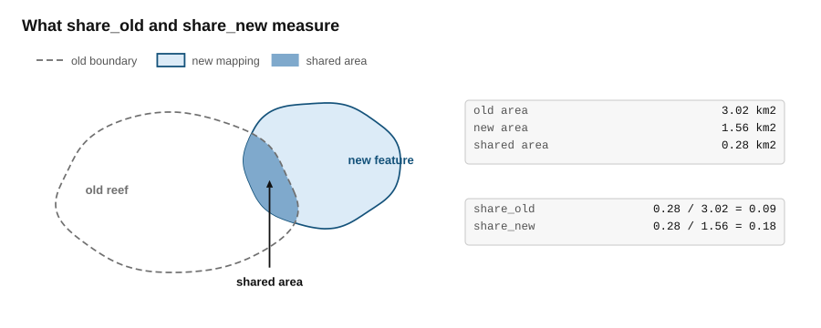
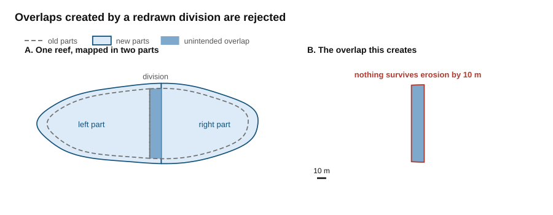
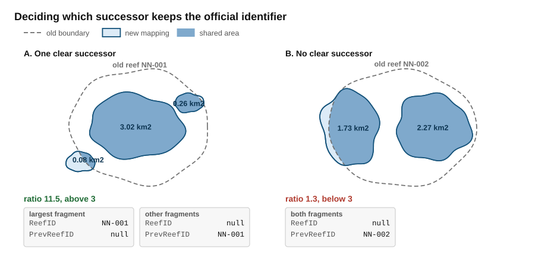
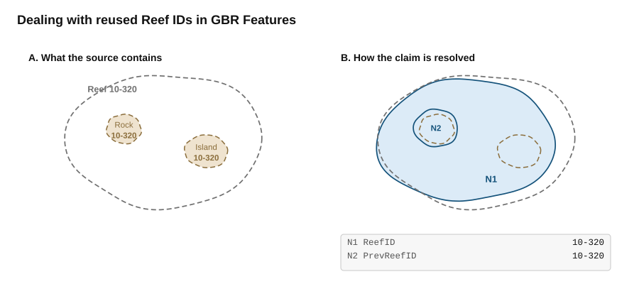
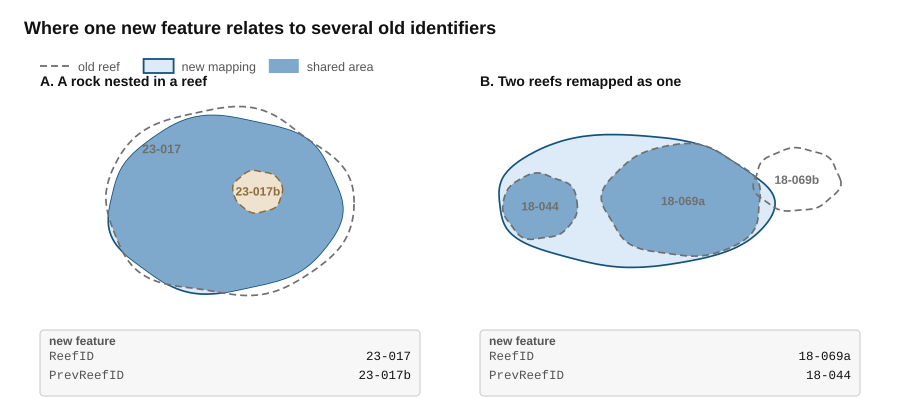
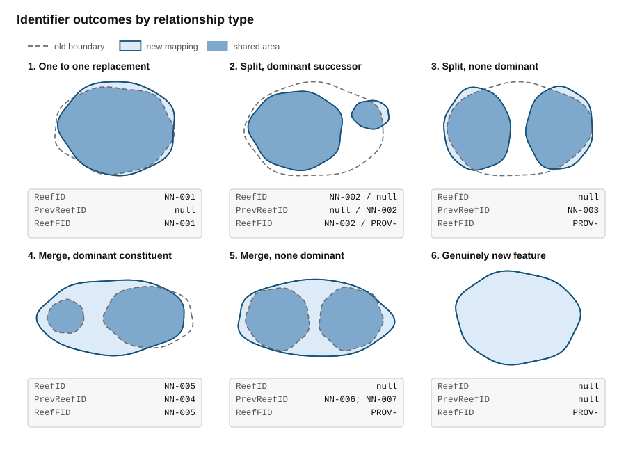

# Assigning previous reef identifiers: proposed solution

This proposal responds to the problem described in `02a-PrevReefID-problem.md`. It sets out a
revised method for deciding which newly mapped features inherit an official GBRMPA identifier,
which features record a previous identifier, and which relationships are ignored as incidental.
It applies to `02a-patch-TS-GBR-Features.py` only. The Coral Sea and North West Australia
datasets manage their own identifiers and arrive at stage 03 complete.

The method described here has been implemented. The sections below have been revised to describe
what the code does rather than what was originally proposed, and the points where implementation
forced a change of approach are noted where they arise. Two elements remain unimplemented, the
`ACTION='ReefID'` override and the `ACTION='NoLink'` suppression, both of which were deferred
until the review outputs show that they are needed. The open decisions that implementation raised
are listed at the end.

## Summary of the approach

Every pair of old and new polygons that intersect is scored once. Pairs that survive a narrow
sliver test and reach a minimum share of either polygon's area become candidate relationships.
An old reef's official identifier then passes to the single candidate that overlaps it most,
provided that overlap is at least three times the next best candidate. Where there is no clear
winner the identifier is not carried forward. It is instead recorded as a previous identifier on
every candidate, leaving the determination to GBRMPA.

The same dominance test is applied a second time, from the other direction. Where one new feature
wins several official identifiers it cannot hold them all, so the test decides whether one of the
old features it absorbed was dominant enough for its identifier to be kept. This second
application was added during implementation and is described under step four.

The method uses three thresholds. This is a deliberate reduction from earlier drafts, which
accumulated separate tests for overlap share, relative feature size and dominance. Each
additional threshold added a small improvement in specific cases but made the method harder to
explain and harder to justify in the dataset documentation. Testing against the current data
showed that a single dominance ratio reproduces the intended outcome in every real case that the
size tests were introduced to handle. Cases that the simplified method treats differently from
expectation are reported for review rather than resolved by another threshold.

## Why the current method fails

The current implementation decides inheritance using intersection over union with a threshold of
0.1. This measure is symmetric, so it falls away rapidly whenever the two polygons differ
substantially in size. A small feature split from a large old reef can lie entirely within the
old boundary and still score below the threshold. A large new feature that completely contains a
small old reef scores below it as well. In both cases the relationship is real and the current
code records nothing.

The consequences are worse than a missing attribute. Old features are deleted whenever a new
feature intersects them at all, regardless of the score. An old reef can therefore be removed
from the dataset with its identifier appearing nowhere in the output. The identity is lost
silently, and nothing in the current run reports it.

The uniqueness test used to detect splits and merges is also unreliable. It counts only those
new features whose candidate set contains exactly one old identifier. If one new feature relates
to old reef X alone and a second relates to both X and Y, the first is treated as the sole
claimant of X and inherits the official identifier, while the second lists X as a previous
identifier. The same official identifier then appears in two roles in the same output.

Features linked by an explicit `CODE` bypass this logic entirely. They always inherit the
official identifier of the feature they reference. In the current input, 18 codes are shared by
48 new polygons, so 18 official identifiers are each assigned to between two and eight features.
Stage 03 currently conceals this by appending `-F01` and `-F02` style suffixes, which presents a
provisional dataset suffix as though it were part of an official identifier.

## Definitions

For an old polygon with area `A_old` and a new polygon with area `A_new` that intersect with
area `A_int`, two shares are defined.

    share_old = A_int / A_old
    share_new = A_int / A_new

All areas are computed in EPSG:3577, an equal area projection, as the current script already
does. The two shares describe the relationship from each side. A split fragment has a low
`share_old` and a high `share_new`. A merged feature has a high `share_old` and a low
`share_new`. Using both is what allows splits and merges to be detected, which a single
symmetric measure cannot do.

**Figure 1.** The two shares are the same shared area divided by each of the two polygon areas in
turn. They differ whenever the polygons differ in size, and it is that difference which carries
the information. A small fragment of a large old reef has a low `share_old` and a high
`share_new`, while a small old reef absorbed into a large new feature has the reverse. A single
symmetric score, such as intersection over union, would report one low number in both cases and
could not tell them apart.

## Step one: reject digitising slivers

Where an old reef is remapped as two or more features, the position of the internal division is
judged by eye. A small overlap with the neighbouring old feature is therefore almost guaranteed,
even though no relationship exists. The same effect arises from coordinate precision and from
minor differences in boundary construction.

An intersection is discarded if it disappears when eroded by 10 m, tested as
`intersection.buffer(-10).is_empty`. This removes any overlap narrower than about 20 m at its
widest point. The test measures how deeply the polygons interpenetrate rather than how much area
they share, which is what distinguishes a long thin contact from a genuine overlap. Area alone
cannot make this distinction, because a long sliver along the edge of a large reef can have more
area than a compact overlap on a small one.

An intersection can be several disjoint pieces, for example where a new feature crosses two arms
of an old reef. The pair survives if any piece survives erosion. The shares are then computed from
the area of the whole intersection, including the pieces that did not survive, because those
pieces are still part of the same relationship once it is established.

The tolerance is reduced on small features. A fixed 10 m is meaningless on a feature whose whole
width is comparable to the tolerance itself, because eroding it leaves nothing regardless of what
the overlap represents. The rock `20-834` is 24 m across and lies 84 per cent inside a new
feature, and the rock `19-009` is 19 m across and lies entirely inside one, yet both were
discarded as slivers. The tolerance is therefore capped at a quarter of the width of the smaller
of the two polygons, measured as the width of its widest part. Above about 40 m across the cap
never binds and the tolerance is the usual 10 m, so only genuinely small features are affected.

Scaling by width rather than by area is what makes this work. A long thin feature and a compact
one of the same area need different tolerances, and it is the narrowness that defeats the test.
The cap does not make small features easier to relate in general, because a rescued pair still
has to pass the share test that follows. It only stops the erosion test from answering a question
it cannot answer. On the current input it keeps 30 pairs that would otherwise have been discarded
and recovers 27 official identifiers, while leaving 13 genuine slivers on small features rejected,
none of which overlaps by more than 0.21 of the old feature.

The test is deliberately not replaced by a minimum overlap area. Area alone cannot distinguish a
long sliver along the edge of a large reef, which can have substantial area, from a compact
overlap on a small one, which does not.

**Figure 2.** A reef historically mapped as two parts is remapped as two parts again, but the
internal division is placed by eye and lands about 14 m from where it was before. The new left
part therefore overlaps the old right part, even though the two have no relationship with each
other. Recording that overlap would associate the two halves of one reef. Panel B shows the
overlap alone at a much larger scale. It is a long thin strip which vanishes entirely when eroded
by 10 m, so the pair is discarded before any share is computed.

## Step two: identify candidate relationships

A surviving intersection becomes a candidate relationship if `share_old` or `share_new` is at
least 0.1. The threshold is deliberately low. Much of the original mapping required substantial
correction, and a strict threshold would reject relationships that are clearly real. The test
applies in either direction so that a small fragment of a large old reef and a large new feature
containing a small old reef both qualify.

The share is computed from the full intersection area, not the eroded geometry. Erosion is used
only to decide whether the contact is meaningful.

A repeated `CODE` on a new feature forces a candidate relationship regardless of geometry. This
is necessary because the move operation exists precisely for features that do not overlap their
original boundary. In the current input, several new polygons carrying a code have no
intersection at all with the feature they reference, so geometry can never recover the link.

## Step three: allocate the official identifier

Candidates are grouped by official identifier rather than by old polygon. The original proposal
grouped by polygon, which fails because the source identifier is not unique. Where a reef and the
rock sitting on it share one `LABEL_ID`, grouping by polygon creates two competing claims on the
same identifier and the method can award it to two different new features. Grouping by identifier
means the intersection areas of every old polygon carrying that identifier are summed against each
new feature, so the group has a single dominant successor or none.

Within each group the candidate with the largest intersection area is identified. That candidate
inherits the official identifier if its intersection area is at least three times that of the next
best candidate in the group. If it is not, no feature inherits the identifier.

A relationship with only one candidate has no runner up, so the ratio is unbounded and the
identifier is always inherited. This reproduces the intended treatment of one to one
replacements without a separate rule. An identifier names a reef, not a shape, so a substantial
change in boundary or area does not by itself break the identity.

**Figure 3.** Where an old reef is remapped as several features, the candidates are ranked by
shared area and the largest inherits the official identifier only if it exceeds the next by a
factor of three. In panel A one fragment covers most of the old reef and the two others are
incidental, so the identifier passes to the dominant fragment and the others record it as a
previous identifier. In panel B the reef divides into two pieces of comparable extent, no
successor is dominant, and the identifier is not carried forward by any of them. Choosing which
of two comparable reefs keeps a name is a decision for GBRMPA rather than for this method. Figures
in the shaded areas are shared area in km². Identifiers are placeholders.

**Figure 4.** The GBR Features convention gives each part of a reef complex its own identifier,
so a reef and the rock on it would be `10-320` and `10-320a`. Where that was missed in the source,
one identifier is left covering several polygons, which affects 660 of the 9,050 source rows.
Grouping the allocation by polygon would then create two independent claims on `10-320` and the
method could award it to two unrelated new features. Grouping by identifier instead treats the
three polygons as a single claim, so the identifier is awarded once and the other successor
records it as a previous identifier.

## Step four: resolve features that win several identifiers

A new feature can win more than one official identifier. This happens where two old reefs are
remapped as one feature, and it happens routinely where a new reef polygon covers both the old
reef and a rock or island nested inside it. The feature cannot hold two official identities, so a
rule is needed to decide between them.

The same dominance test is applied to the identifiers the feature won, using the candidate
intersection area of each. Where the largest is at least three times the next largest, the feature
keeps that identifier and records the others as previous identifiers. Where it is not, the feature
takes none of them and all are recorded as previous identifiers, which refers the merge to GBRMPA.
The winners from step three are then rebuilt to reflect these outcomes, so that an identifier
released at this step is reported as unallocated rather than as inherited.

Without this rule a merged feature refuses every identifier, which is wrong in the common cases.
Pelican Island Reef `23-017` is the nested case. The new 0.772 km² polygon wins both the 0.908 km²
reef `23-017` and the rock `23-017b` inside it, and the rule keeps `23-017` with `23-017b` recorded
as a previous identifier. Reefs `18-044` at 4.4 km² and `18-069a` at 33.1 km² remapped as one
58.8 km² feature are the merge case, and the rule keeps `18-069a` with `18-044` recorded as
previous. Reusing the existing ratio rather than introducing a fourth threshold keeps the method
explainable, and it produced the expected result in every case examined.

The outcome for each new feature then follows. A feature holding one identifier after this step
takes that value as its `ReefID` and records any other candidate identifiers in `PrevReefID`. A
feature holding none records its candidates in `PrevReefID`, or null if it has no candidates at
all, in which case it is treated as genuinely new.

An identifier held as `ReefID` is never repeated in `PrevReefID` on the same feature.

**Figure 5.** A new feature can win more than one official identifier, and the same dominance
test decides which identity it keeps. In panel A a new reef polygon covers both Pelican Island
Reef `23-017` and the rock `23-017b` nested inside it, so it wins two identifiers. The reef
dominates the rock by area, so the reef identity is kept and the rock becomes a previous
identifier. In panel B two old reefs are remapped as one feature. `18-069a` dominates `18-044`,
so the merged feature keeps `18-069a` and records `18-044` as previous. The third reef `18-069b`
touches the new feature but too little to pass the 0.1 threshold, so it is not a candidate at all
and keeps its own identifier on its own mapping.
## Manual overrides

The method decides every case, so overrides are needed only where the automated outcome is
wrong. Two additional values are proposed for the `ACTION` attribute of the existing Remove-Move
point file. Both require only a point and a value already chosen from a list, so the editing
effort matches the existing move and remove operations. No identifier needs to be created or
maintained on either layer, which keeps the relationship visual and avoids the stable input
identifier problem described in the problem statement.

A point with `ACTION='Link'` placed where a new and an old polygon overlap forces a candidate
relationship that can only ever produce a previous identifier. It never inherits the official
identifier. This is intended for the marginal overlaps that the review outputs raise, where the
editor confirms a relationship that the thresholds reject.

A point with `ACTION='ReefID'` placed inside a new polygon names that polygon as the recipient of
the official identifier, overriding the dominance test. This answers the case where several
features share a code and the editor knows which one should carry the identity. The point resolves
by point in polygon against the new mapping, and the identifier follows from that feature's own
candidate set. This override is expected to be rare, and has not been implemented. The accepted
values are `Move`, `Remove` and `Link`, and the script halts on any other value, so adding a
`ReefID` point before the code supports it stops the run rather than being silently ignored.

Polygons do not overlap within either layer, so a point resolves to at most one old feature and
one new feature and the pair it refers to is unambiguous. Override points must be resolved
against the filtered old layer rather than the unfiltered one. The unfiltered layer contains
island and cay polygons that sit inside reef polygons, where a point would match two features.

## Validating overrides

An override records a decision made against the mapping as it stood when the point was placed.
The mapping continues to change, so an override can become wrong without anything visible
happening. Each point is therefore checked on every run and reported rather than applied where it
no longer holds.

A `Link` point must fall inside both a new and an old polygon, and the pair it identifies must
intersect. A `ReefID` point must fall inside a new polygon that has at least one candidate
relationship. A point that resolves to no feature, or to a pair that no longer intersects, is
reported as obsolete. This is the case where the boundary has since been redrawn and the
relationship the editor confirmed no longer exists.

An override is also reported where it has become unnecessary. A `Link` point on a pair that now
passes the candidate test on its own, or a `ReefID` point on a feature that would win the
identifier without it, no longer changes the outcome. These are not errors, but they should be
removed so that the remaining points are a short list of real decisions rather than an
accumulating record of past ones. A `Link` point that duplicates an existing move relationship is
reported for the same reason.

Obsolete and unnecessary points are written to a review output with the reason recorded against
each one. They do not stop the run. Applying a stale override silently is the outcome worth
avoiding, and reporting achieves that without blocking processing.

## Identifier outcomes

| Relationship | `ReefFID` | `ReefID` | `PrevReefID` |
|---|---|---|---|
| Clear one to one replacement | Inherited `ReefID` | Inherited official identifier | Other candidate identifiers, or null |
| Old feature split with a clear dominant successor | Inherited `ReefID` on the successor, provisional on the others | Official identifier on the successor, null on the others | The old identifier on the non successors |
| Old feature split with no dominant successor | Provisional on every candidate | Null | The old identifier on every candidate |
| New feature combining several old features, one dominant | Inherited `ReefID` | The dominant constituent's identifier | The other constituents' identifiers |
| New feature combining several old features, none dominant | Provisional | Null | All candidate identifiers |
| Genuinely new feature | Provisional | Null | Null |
| Retained old feature | Existing `LABEL_ID`, with an `-Fnn` suffix where shared | Existing `LABEL_ID` | Null |

**Figure 6.** The six relationship types and the attributes each produces. Official identifiers
are kept only where one successor or one constituent is clearly dominant. Everywhere else the
association is still recorded, as a previous identifier, without claiming the identity. The
distinction matters because a previous identifier is a statement about history, which can be made
safely, while an official identifier is a statement about which reef this is, which cannot be
made on this project's authority. Identifiers are placeholders and `PROV-` denotes a provisional
dataset identifier.

Provisional identifiers keep the existing `PROV-{lat}-{lon}` form. `PrevReefID` remains a
semicolon separated list. The list is unordered, because ordering by overlap could not be
maintained across versions without recomputing the comparison against every earlier release. In
future versions the field should accumulate as a set union, so that it reads as the set of
identifiers by which this location has previously been known.

## Displaying identifiers on maps

The conservative allocation leaves a third of the new mapping without an official identifier, so a
map labelled from `ReefID` alone loses labels on features that users recognise by number. A display
attribute named `ReefLabel` is therefore built in stage 03, after `ReefFID` allocation, so that it
covers every region rather than the Great Barrier Reef alone. It holds the official identifier
where one exists, otherwise all previous identifiers joined and wrapped in a marker, otherwise
null.

    ReefID   PrevReefID        ReefLabel
    15-010   None              15-010
    None     11-273            [11-273]
    None     18-044;18-069a    [18-044; 18-069a]
    None     None              (blank)

The attribute is a presentation convenience and carries no information that is not already in
`ReefID` and `PrevReefID`. It exists because expressing this rule in a QGIS label expression is
awkward to write and easy to get wrong, and because the dataset is intended to be usable without
configuration. All previous identifiers are shown rather than a single one, because showing only
the first would present an arbitrary part of the location's history as though it were the whole.
The name is ten characters, so it survives shapefile field name truncation unchanged.

The wrapper is a single constant, `PREV_LABEL_FORMAT`, so the convention can be changed without
touching the logic. Brackets are the current choice, but square brackets may read as an editing
mark rather than as a qualification, and the alternative is a prefix or a different bracket style.
This has to be judged against a labelled map at real scales rather than decided from the rule, so
the value is expected to change once that check is made.

## Relationship to deletion

The rule for deleting old features does not change. Any intersection with a new feature still
removes the old feature, because the presence of new mapping at that location means the old
boundary is superseded. Move and remove operations delete as they do now. Deletion and lineage
are therefore decided independently, which is why an old feature can be deleted without its
identifier being carried forward. That situation is the main thing the review outputs are
designed to surface.

## Review outputs

Six layers are written to `working/02/debug-reefid-review.gpkg` on every run. A GeoPackage is
used rather than separate shapefiles because it holds all the layers in one file and does not
truncate field names to ten characters, which matters when the attributes include two shares and
several areas. The dataset outputs remain shapefiles. Spatial outputs are used throughout rather
than tables, because every case requires looking at the location in QGIS to judge it. A layer with
no records is skipped and reported in the run output, so an empty layer is never mistaken for a
layer that failed to write.

Orphaned identifiers are old features that were deleted but whose identifier appears in no
`ReefID` and no `PrevReefID` in the output. Apart from deliberate removals this list should be
empty. Each record carries the old geometry, `ReefID`, `CODE` and area, and the reason the feature
was deleted, which is either a remove point, a move, or overlap by a new feature.

Sub-threshold overlaps are intersecting pairs that survive the sliver test but fail the 0.1 share
test. Each record is the intersection geometry, attributed with the old `ReefID` and `CODE`, the
area of the old polygon, the area of the new polygon, the intersection area, both shares, and a
flag marking pairs where the old feature has no other candidate. Those flagged pairs are the ones
most likely to be a one to one replacement that the threshold has missed, so they are the first
place to look for a missing move operation. This layer is also the evidence for whether 0.1 is set
correctly.

Extreme size changes are inherited relationships where the new feature's area differs from the old
feature's by more than a factor of five. Each record carries the new geometry, the inherited
identifier, both areas and the ratio between them. These are reported to test the assumption that
identity survives large boundary corrections. Only relationships that actually resulted in
inheritance are listed. An earlier version of this layer also included features that went on to
win a second identifier and therefore took none, which accounted for 290 of 483 records and made
the layer unusable for its intended purpose.

Override problems are the obsolete and unnecessary points described above, carrying the point
geometry, the `ACTION` value, the features it resolved to, and the reason it was reported.

Inshore gaps are old features that survive into the output but lie within the inshore extent that
was nominally remapped. Each record is an old feature that should have been replaced by new
mapping and was not, so the layer measures how complete the inshore remapping is. It is a report
rather than a blocking check, because the remapping is incomplete by intent and will remain so
until the editing is finished. Halting on it would prevent the pipeline running at all during the
period when the layer is most useful.

Shared `ReefID` values are features in the output that hold an official identifier also held by
another feature. The original proposal made this a hard validation on the assumption that the
condition could not arise. It can, because the source identifier is not unique, so a retained reef
and a retained rock legitimately share one. The check is therefore a report, and it is the place to
look if a future change to the allocation starts splitting identifiers that should not be split.

None of these layers stops the run. Move and remove validation failures continue to halt
processing, because those indicate an input that cannot be interpreted. The review layers describe
outcomes that are interpretable but may be wrong, and halting on them would mean the script could
not complete until every marginal case had been dismissed with a point. Orphaned identifiers are
the closest case for halting, since each one is a lost official identifier, and that could be made
a blocking check once the list has been worked down to a stable set of deliberate removals.

The run also prints a summary of the counts that appear in the problem statement and in the
dataset documentation. These are the number of features by identifier outcome, the number of
split groups with and without a clear successor, the number of coded features with no overlap,
and the number of orphaned identifiers. Quoting these figures from the run rather than counting
them by hand means the written description can be refreshed as the editing files are corrected,
which will happen repeatedly before publication.

## Evidence from the current input

The method was tested against the 18 codes that are shared by more than one new polygon. These
are the clearest split cases in the data and the ones the current implementation handles worst.

| Old code | Old area km² | Best overlap km² | Next best km² | Ratio | Outcome |
|---|---|---|---|---|---|
| 10-303-104-104 | 3.34 | 3.316 | 0.002 | 1400 | Inherited |
| 10-305-104-100 | 28.12 | 25.315 | 2.784 | 9.1 | Inherited |
| 10-318-101-104 | 0.68 | 0.163 | 0.086 | 1.9 | Referred |
| 10-337-100-104 | 0.63 | 0.364 | 0.232 | 1.6 | Referred |
| 10-532-104-100 | 0.04 | 0.033 | 0.002 | 14.9 | Inherited |
| 11-140-100-104 | 0.64 | 0.323 | 0.000 | unbounded | Inherited |
| 11-149-100-104 | 11.67 | 0.419 | 0.180 | 2.3 | Referred |
| 13-031-100-104 | 0.86 | 0.537 | 0.000 | unbounded | Inherited |
| 13-114-100-104 | 0.30 | 0.024 | 0.000 | unbounded | Inherited |
| 14-010-100-104 | 10.07 | 1.268 | 0.173 | 7.3 | Inherited |
| 14-108-100-104 | 1.59 | 0.285 | 0.088 | 3.2 | Inherited |
| 15-084-100-104 | 12.02 | 12.008 | 0.000 | unbounded | Inherited |
| 19-205-102-104 | 2.42 | 1.229 | 1.194 | 1.0 | Referred |
| 19-205-103-104 | 15.01 | 11.989 | 1.978 | 6.1 | Inherited |
| 20-041-104-104 | 2.49 | 0.266 | 0.176 | 1.5 | Referred |
| 23-010-100-104 | 0.67 | 0.198 | 0.002 | 130 | Inherited |
| 23-012-104-104 | 0.52 | 0.037 | 0.000 | unbounded | Inherited |
| 23-061-103-104 | 1.04 | 0.413 | 0.314 | 1.3 | Referred |

Twelve groups produce a clear successor and six are referred to GBRMPA. The referred cases are
those where the old reef divides into pieces of comparable extent, such as 19-205-102-104 at
0.507 against 0.493, or where every piece is small relative to the original, such as
11-149-100-104 where the largest fragment covers 3.6 per cent of an 11.7 km² reef. This second
case was the main reason for proposing a separate size test. The dominance ratio rejects it on
its own, at 2.3, which is why the size test was removed.

## Parameters

| Name | Value | Purpose |
|---|---|---|
| `SLIVER_TOLERANCE_M` | 10 | Erosion distance below which an intersection is treated as a digitising artefact |
| `SLIVER_WIDTH_FRACTION` | 0.25 | Cap on the erosion distance as a fraction of the smaller feature's width, so the test is not applied at a scale the feature cannot support |
| `CANDIDATE_SHARE` | 0.1 | Minimum share of either polygon's area for a candidate relationship |
| `DOMINANCE_RATIO` | 3.0 | Factor by which the best candidate must exceed the next best to inherit the identifier, applied both when allocating an identifier among candidates and when a feature holds several identifiers |
| `SIZE_CHANGE_REPORT` | 5.0 | Area ratio above which an inherited relationship is reported for review |

The first four affect the output. The last affects only the review outputs, so an incorrect
value produces a longer or shorter list to check and cannot corrupt the dataset. None of these
values has been validated against manual assessment. The sub-threshold overlap output exists so
that `CANDIDATE_SHARE` can be reviewed against real cases before publication.

## Changes required to the code

The pair scoring replaces `compute_iou` in `02a-patch-TS-GBR-Features.py`. Features carrying a
`CODE` currently bypass overlap analysis entirely and are handled in a separate branch. They
would instead contribute a forced candidate and then pass through the same allocation, which
removes the duplicate identifier problem at its source and lets a moved feature also record
previous identifiers where its new boundary genuinely overlaps other old reefs. The claimant
counting in step 5b of the current script is replaced by the grouping and dominance test.

The validation that every move point resolves to a code present in the new mapping is unchanged.
A validation that no official identifier appears as `ReefID` on more than one feature was proposed
as a hard check. It is implemented as a report instead, because the source identifier is not unique
and the condition arises legitimately. On the current input 16 identifiers are shared in this way.

The suffix allocation in `reeffid_utils.py` is retained, and it is still required rather than being
a safeguard. The proposal assumed that only one feature per old identifier could hold a `ReefID`,
which would have made the suffixes unnecessary. Because a reef and its associated rock share an
identifier in the source, several retained features can hold the same `ReefID`, and the `-Fnn`
suffixes remain the means of giving each a unique `ReefFID`.

The design document `02a-patch-TS-GBR-Features_design.md` has been rewritten to match, replacing
its overlap threshold and reef identification sections. The note in that document proposing
assessment of the intersection as a proportion of both areas is superseded by this proposal.

## Results from the implemented method

The figures below are from the current input and will change as the editing files are corrected.
They are recorded here as the state at which the method was accepted, not as a property of the
method.

Of 4,560 new features, 1,207 inherit an official identifier, 1,018 carry a previous identifier
only, and 2,335 are genuinely new. Of the new features that merge several old reefs, 184 in total,
113 keep the identifier of the dominant constituent and 71 are referred to GBRMPA. Of the split
groups, 211 have a dominant successor and 204 are referred. Scoring covered 7,397 old features and
found 2,811 intersecting pairs, of which 77 were rejected as slivers, leaving 2,689 candidate
relationships including 98 forced by a code with no overlap. A further 30 pairs were kept by the
reduced tolerance on small features. In the review outputs there are 150 orphaned identifiers, of
which 118 follow a deliberate remove point, 19 failed the share test and 13 were rejected as
slivers, along with 145 sub-threshold overlaps, 210 extreme size changes, no override problems,
and 88 inshore gaps.

The size profile of the new features explains why the display attribute was needed. Features
inheriting an official identifier have a median area of 0.48 km², those carrying a previous
identifier only 0.13 km², and those with neither 0.08 km². The unlabelled features are
predominantly small, but 139 of them exceed 2 km², which is large enough to expect a label on a
regional map.

The worked cases in the table above reproduce exactly, and the merge and nesting cases resolve as
intended.

    ReefID   PrevReefID   Old codes
    23-017   23-017b      23-017-102-108;23-017-100-104
    18-069a  18-044       18-069-101-104;18-044-100-104
    18-069b  None         18-069-102-104

The third row is worth noting. The 58.8 km² merged feature touches `18-069b` along about 130 m of
boundary, which is a real intersection that survives the sliver test. Both shares are far below the
candidate threshold, at 0.0012 and 0.0004, so the contact appears only in the sub-threshold layer
and `18-069b` keeps its identifier. This is the intended behaviour for incidental contact between
neighbours and is the clearest evidence that the share test is doing the work expected of it.

## Open decisions

Several questions were raised during implementation and deliberately left unresolved. They are
recorded here so that the reasoning is not lost.

The provisional identifier form is unsettled. Where a feature has exactly one candidate identifier
but does not qualify to inherit it, the current `PROV-{lat}-{lon}` form discards the only
information a user would find useful. A form derived from the old identifier, such as
`PROV-11-173-01`, would keep the association visible while remaining unmistakably not an official
identifier. This only works where there is a single candidate, so the coordinate form has to remain
as the fallback for merges with no dominant constituent and for genuinely new features. The risk is
entrenchment. A provisional identifier that reads like an official one may be adopted by users and
become difficult to retire once GBRMPA makes a determination.

Whether to clip against the coastline before computing size ratios is undecided. Old mapping often
extends across land where the new mapping does not, which inflates the apparent size change. The
question is not only whether to clip for the size report, which is safe, but whether to clip before
computing the shares and the dominance test, which would change which relationships qualify.

The value of `SIZE_CHANGE_REPORT` is unresolved at 5.0, giving 207 records. Changing it before the
underlying cases are worked through would only change the length of the list.

The 70 referred merges have not been examined by constituent type. If most are a reef merged with a
rock rather than two reefs, a rule that a rock constituent cannot block a reef constituent from
inheriting would resolve them without a further threshold. This should be measured before the rule
is considered.

Whether to exclude rocks from the inshore gap report is undecided. Of the 88 records, 45 are rocks
that were not remapped by intent. Excluding them shortens the list, but keeping them means every
remaining gap is an explicit decision rather than an omission. The current preference is to keep
them until the reef gaps are worked down.

## Limitations

The method does not determine whether a relationship is real. It measures geometric overlap and
applies thresholds chosen on judgement, so it will misclassify cases where the original mapping
is displaced far enough that no meaningful overlap remains. Those cases depend on the editor
adding a move operation, and the sub-threshold output is the means of finding them.

The dominance ratio assumes that a single dominant successor is a reasonable interpretation of a
split. Where an old polygon covered two reefs that were always distinct, and the new mapping
separates them unevenly, the larger will inherit the identifier even though the smaller has an
equal claim to it. The extreme size change output partly addresses this, and the `ReefID`
override handles the remainder.

Decisions made manually are recorded only where an override point is added. An overlap assessed
and dismissed without adding a point remains geometrically identical to an unresolved one and
will be raised again on the next run. If this proves burdensome, a third `ACTION` value marking an
overlap as assessed and incidental would suppress it, but this should not be added until the
volume of repeated cases justifies it.
