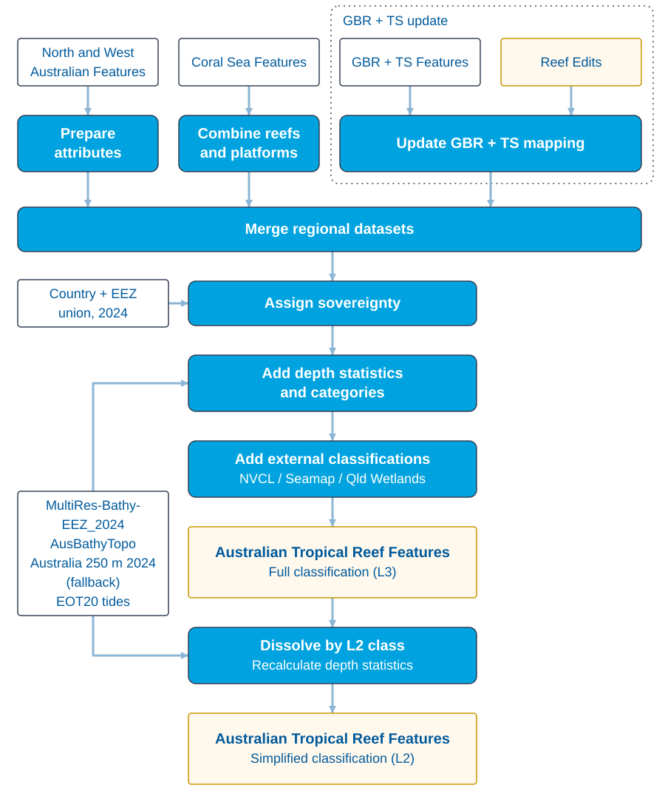

# Australian Tropical Reef Features
This dataset is a compilation and standardisation of multiple reef mapping datasets to produce a national scale dataset that covers rocky and coral reefs for tropical Australia. It combines mapping from:
1. GBRMPA Great Barrier Reef Features, refreshed from the current GBRMPA source and improved through manual edits, mostly on the inshore areas.
2. Torres Strait Features (Lawrey and Stewart, 2016)
3. Coral Sea Features (Lawrey and Bycroft, 2025a)
4. North and West Australian Features (Lawrey and Bycroft, 2025b)

All features were standardised to the Reef Boundary Type v0-4 classification. Where depth categories were not previously assigned (Torres Strait, GBR) the depth of the features was estimated using two datasets. For reefs inside the EEZ the Multi-resolution bathymetry composite surface for Australian waters (EEZ) (Flukes, 2024) was used. For reefs outside the EEZ the AusBathyTopo (Australia) 250m 2024 (Geoscience Australia, 2024) bathymetry was used.

Each of the features were assigned their sovereignty using Flanders Marine Institute, 2024, to allow easy filtering of reefs to those inside the Australian EEZ.

After depth category estimation, `RB_Type_L3`, `Attachment` and `DepthCat` are used to crosswalk to the Natural Values Common Language, Seamap Australia and Queensland Wetlands classifications.

## Release status and documentation

This repository is being prepared for `v1-0`. The current [configuration](config.ini) selects national version `v1-0`, North and West Australian Features `v1-2`, and Coral Sea Features `v1-2`. These settings describe the build, not confirmation that the corresponding download has been published. Check the metadata record and download directory for available releases.

The [dataset LLM primer](Aus-Trop-Reef-Features-LLM-primer.md) describes the analysis schema, identifiers and limitations. The [Reef Boundary Type primer](Reef-boundary-type-scheme-LLM-primer.md) defines the classification. The [changelog](CHANGELOG.md) records processing and mapping changes.

The [report analysis provenance notes](report-analysis-provenance.md) record supporting calculations and approximate assessments that are not reproduced in full in the technical report. Entries have stable note identifiers so they can be located from digital or printed report references.

## Dataset metadata
To download and find out more information see the metadata record for this dataset:
Lawrey, E., Bycroft, R. Australian Tropical Reef Features - Boundaries of coral and rocky reefs (NESP MaC 3.17, AIMS) [Data set]. eAtlas. https://doi.org/10.26274/4RRW-RR88

Use the citation year and version in the metadata record for the release used. Downloads are available from the [eAtlas download directory](https://nextcloud.eatlas.org.au/apps/sharealias/a/AU_NESP-MaC-3-17_AIMS_Aus-Trop-Reef-Features). The dataset is licensed under [Creative Commons Attribution 4.0 International](https://creativecommons.org/licenses/by/4.0/).

## Dataset products

The processing scripts write the following products under `data/{version}/out/`:

| Product | Location | Use |
| --- | --- | --- |
| Full classifications, stage 06 | `full-classes/AU_NESP-MaC-3-17_AIMS_Aus-Trop-Reef-Features_{version}.shp` | Source polygons with identifiers, sovereignty, depth statistics and classification crosswalks. |
| Dissolved L2 polygons, stage 08 | `simp-classes/AU_NESP-MaC-3-17_AIMS_Aus-Trop-Reef-Features_L2_{version}.shp` | Singlepart L2 geometry with aggregated attributes, including source identifiers. Not a named-reef or countable-reef layer. |
| Report summaries, A01 | `stats/A01-summary-stats_{version}.md` and numbered table CSVs | Source counts and areas, plus counts and unrounded areas from the stage 08 L2 polygons, for the technical report. |
| Regional reef distribution, A05 | `stats/Aus-Trop-Reef-Features_Region-stats_{version}*` and `stats/A05_Report-tables_{version}.md` | Countable coral and rocky reef statistics for IMCRA, analysis regions and CAPAD, with captioned report tables recording the dataset version and analysis script. |
| DepthCat and DEM comparison, A06 | `stats/A06_DepthCat-DEM-comparison_{version}.md` and `.csv`, `stats/A06_filter-search_{version}.csv`, `stats/A06-plots/` | Regional depth distributions, balanced-accuracy thresholds with bootstrap intervals, type splits and an independent quality-filter search. DEM-based indications, not validated optical calibrations. |
| GBR and Torres Strait remapping, A07 | `stats/A07-gbr-ts-remap-stats_{version}.md` | Final updated/new feature counts, original Reef Edit counts, and explicit removals and moves, split by inshore GBR and the remaining GBR + Torres Strait. Run `python A07-gbr-ts-remap-stats.py` after stage 06 using matching editing and legacy inputs. See the [specification](A07-gbr-ts-remap-stats-spec.md). |
| GBR Features source reef area, A08 | `stats/A08-gbr-features-reef-area_{version}.md` | Summed GBRMPA GBR Features `Reef`, `Rock` and `Sand` record areas clipped to the GBR Analysis-region, compared with Hopley et al. (2007). Also applies A05's countable-reef rules to GBR Features in stages (size only, separation only, both) for comparison with the A05 GBR count. Invalid source rings are repaired in memory with `make_valid`. Run `python A08-gbr-features-reef-area.py`. See the [specification](A08-gbr-features-reef-area-spec.md). |

A07 repairs invalid polygon geometries in memory for spatial allocation and exports problem locations to `working/{version}/A07/invalid-polygons.shp`. Console warnings distinguish stored geometry failures from projection issues. It does not change source shapefiles. Review stored failures before publication.

Both national shapefiles use GDA94 geographic coordinates (EPSG:4283). `Area_km2` is calculated in GDA94 / Australian Albers (EPSG:3577) and rounded to four decimal places. Previous releases used EPSG:3112, which is not equal-area. Do not mix their stored areas with corrected `v1-0` areas. Polygon counts, dissolved L2 counts and A05 countable-reef counts measure different things.

The [v1-0 summary statistics](data/v1-0/out/stats/A01-summary-stats_v1-0.md) record **25,257 source feature polygons**, including 16,738 classified as Coral Reef and 6,043 as Rocky Reef at L2. These are source record counts, not counts of named or countable reefs.

## Environment Setup
The following setup is needed to reproduce or extend this dataset. The output files are generated by the processing scripts. Manual modifications to the TS-GBR-Features datasets are recorded in edit and remove-move shapefiles. The EEZ union requires manual download. The GBRMPA source is supplied in the dataset's downloadable `in-3p-mirror` folder because GBRMPA GeoHub does not allow programmatic download. Reproduction also requires the version-specific inputs to have been published or supplied locally.

Setting up the working environment is only needed if you want to reproduce this work, or extend it to make improvements. This is not needed if all you want to do is use the final dataset.

## Tools used:
- Python - Run scripts that download all source data, then adjust and normalise the input data to allow them to be merged into the final dataset. This is setup using Conda.
- QGIS - This is used for adjusting the manual clean up and override shapefiles that are applied to the TS-GBR mapping. This is also useful for checking the output files.
- FFMpeg and [QGIS Animated Atlas plugin](https://github.com/open-AIMS/qgis-animated-atlas) for animated preview map.

## Python setup
There are many ways to setup Python. In this project we use conda to create an environment that contains all the libraries needed for the analysis. The version of Python and the libraries is described in the `environment.yml` file. This includes the specific versions of the libraries used. We specify the version of the libraries to ensure reproducibility of the analysis, but also to speed up the setup of the Python environment as conda resolves dependencies faster when it knows the versions of the libraries it should use.

Conda is a package manager that allows a specific version Python and associated libraries to be installed into an environment that is separate from other Python installations on your machine. [Miniconda](https://www.anaconda.com/docs/getting-started/miniconda/main) is a minature installation of the Anaconda Distribution and is the smallest footprint version of using conda.

To install miniconda follow its [installation guide](https://www.anaconda.com/docs/getting-started/miniconda/install). 

To setup the environment for this dataset run:
```bash
cd {path to the AU_NESP-MaC-3-17_AIMS_Aus-Trop-Reef-Features dataset} 
conda env create -f environment.yml
```
2. Activate the environment
```bash
conda activate AusTropReef
```

You are now ready to run the scripts that generate the dataset. 

# Reproducing this dataset:
This section details how to reproduce this dataset from scratch starting with just the source code.



The workflow combines the regional mapping, adds sovereignty and depth information, and generates the full-classification and simplified L2 products.

All intermediate files, QA layers and caches are stored under `working/{version}/{stage}/`, using `[general] version` from `config.ini`. This includes the stage 03 review output in `working/{version}/03-review/` and the DEM mosaic shared by stages 05 and 08 in `working/{version}/05/`. Changing the version isolates working files from previous releases. Existing unversioned working folders are not automatically read or moved; rerun stages 01d onwards to rebuild them in the versioned layout. Published outputs remain under `data/{version}/out/`.

1. Clone this dataset to your local machine. For this you will need Git installed, or you will need to download the zipped version of the source from GitHub.
2. Edit the `config.ini` to specify where you want to store the downloaded input datasets. Allow at least 274 GB for source data, plus space for working files and outputs. The source-data estimate comes from the earlier workflow and can change with source versions. Much of this storage is needed for bathymetry and satellite imagery.
3. Setup your Python environment to run the scripts for the dataset (see the Python setup section)
4. Run `python 01a-download-input-data.py` to download the input source datasets. Third party inputs are saved under the configured `in_3p_path` and manual correction inputs under `in_path`. These default to `data/{version}/in-3p/` and `data/{version}/in/`. The version is specified in `config.ini`. The script downloads the national `in` directory only when `in_path` does not already exist, to avoid overwriting manual edits. An existing but incomplete folder therefore needs to be checked manually. Downloads can take a long time. Rerunning skips previously downloaded datasets, but does not resume a partial download of a single dataset.
5. Download the satellite imagery by running `python 01b-download-sentinel2.py`. Setup virtual rasters for the satellite imagery by running:
```bash
python 01c-create-virtual-rasters.py --base-dir data/{version}/in-3p/S2
```
6. Download the version's `in-3p-mirror` folder from the [dataset download directory](https://nextcloud.eatlas.org.au/apps/sharealias/a/AU_NESP-MaC-3-17_AIMS_Aus-Trop-Reef-Features) and extract it to `data/{version}/in-3p-mirror/`. It includes `GBRMPA-GBR-Features/Great_Barrier_Reef_Features.shp` and its associated shapefile files, so reproducing the dataset does not require a separate download from GBRMPA. Stage 01a does not download this folder, and stage 01d reads it directly rather than using `in_3p_path`.

   **Source acquisition record:** The mirrored [GBRMPA Great Barrier Reef Features](https://reef-geohub-ext-geohubgbrmpa.hub.arcgis.com/datasets/816f4d747cd94d84acfd924b27f581d8_64/about) was downloaded manually because GBRMPA GeoHub does not allow programmatic download. To obtain an updated source for a future build, download it from GeoHub as a shapefile and place the complete set of files, including `.shp`, `.shx`, `.dbf` and `.prj`, in the same mirror folder. Retain the download date and source metadata with that copy.

   Run `python 01d-refresh-TS-GBR-Features.py` to replace the stale GBR portion of the integrated Torres Strait and GBR layer. The refreshed intermediate layer is saved to `working/{version}/01/TS-GBR-Features-latest.shp`.
7. Prepare the regional layers in this order:
   - Run `python 01e-clip-TS-GBR-reef-edit.py` to clip the Reef Edit polygons to the coastline (`working/{version}/01/Reef-Edit-clipped.shp`), which is the Reef Edit input to stage 02a. Splits produce a warning and QA layers; multipart sources, features with no marine remainder and invalid geometry stop the run. Multipart errors include a `$id IN (...)` expression to paste into QGIS's **Select features using an expression** on the source Reef Edit layer. This selection is independent of attribute-table sorting. See [01e-clip-TS-GBR-reef-edit-spec.md](01e-clip-TS-GBR-reef-edit-spec.md).
   - Run `python 02a-patch-TS-GBR-Features.py` to apply the GBR and Torres Strait corrections and assign identifiers.
   - Run `python 02d-clip-TS-GBR-legacy.py` to clip retained legacy features to the coastline (`working/{version}/02/TS-GBR-Features-clipped.shp`, the input to stage 03). Any legacy split or removal blocks the run until it is corrected through Reef Edit or an explicit removal; rerun stages 01e, 02a and 02d after each correction. See [02d-clip-TS-GBR-legacy-spec.md](02d-clip-TS-GBR-legacy-spec.md).
   - Run `python 02b-patch-NW-Aus-Features.py` and `python 02c-patch-CS-Features.py` to standardise the other regional datasets. These stages are independent of the TS-GBR correction sequence.

   Both clipping stages require `{in_path}/Land-exclusion/Land-exclusion-piers.shp`. These manually mapped polygons identify elevated pier footprints that must not exclude the reef beneath them. The polygons are subtracted from the working coastline mask before reef clipping; neither source shapefile is modified. Missing or invalid exclusions stop the run. A valid empty polygon layer can represent versions with no exclusions. After changing the exclusions, rerun stages 01e, 02a and 02d before stage 03.

   Clipping removes changed marine fragments smaller than 100 m², measured in EPSG:3577. Unchanged features and mapped cays are exempt from fragment filtering; mapped cays are also exempt from land subtraction. Review the split QA layers before publication, including copied `Attachment` and `EdgeAcc_m` values.

   The Coral Sea script uses `CS_RB_Type_L3_v0-3` to translate to `RB_Type_L3_v0-4` in the configured NW-Aus-Feat crosswalk. This source column is required: Coral Sea Atoll Platform excludes separately mapped reefs and maps to Oceanic Platform (Sediment at L2), whereas the NW `RB_Type_L3_v0-3` classification maps Atoll Platform to Coral Reef Bank (Coral Reef at L2).

   Coral Sea `FeatConf` and `TypeConf` values of `Very high` and `High` are standardised to `High` in stage 02c for both Reefs and Cays and Atoll Platforms. Other confidence values, including blanks, are unchanged. See [02c-patch-CS-Features-spec.md](02c-patch-CS-Features-spec.md). Rerun stage 02c and downstream stages 03 to 06 to update the national dataset, then stage 08 to rebuild the L2 product. Invalidate affected A05 caches before regenerating regional statistics.

   **Which 02a script?** Use [02a-patch-TS-GBR-Features.py](02a-patch-TS-GBR-Features.py) for `v0-9` onwards, including `v1-0`, after running stage `01d`. [02a-patch-TS-GBR-Features_v0-1.py](02a-patch-TS-GBR-Features_v0-1.py) is retained only for historical reference to the `v0-1` point-override workflow. Do not run it for the current release. Its fixed-version output is isolated in `working/v0-1/02/TS-GBR-Features-patched.shp`; the current script uses the configured dataset version.

   Stage 02a maps source `CLASS_CONF` values of `LowHigh` to `Low` when creating `TypeConf` for retained Torres Strait and GBR features. Other confidence values and blanks remain unchanged. Rerun stage 02a and downstream stages 03 to 06, then stage 08, to propagate this correction. Invalidate affected A05 caches before regenerating regional statistics.

8. Run `03-merge-TS-GBR-CS-NW.py`. This script merges all the normalised reef datasets into a single national dataset. This does not have the depth attributes, the country information or the crosswalks to the NVCL set.
   Development only: `python 03-merge-TS-GBR-CS-NW.py --allow-review` reads the raw stage 02a output, bypassing the stage 02d gate, and writes to `working/{version}/03-review`. Its output is not for publication.
9. In preparation to assigning each reef to a country download the Union of the ESRI Country shapefile and the Exclusive Economic Zones dataset. This is needed to assign the Country attribute to the reefs. This dataset is not automatically downloadable by script and so must be downloaded manually.

    Flanders Marine Institute (2024). Union of the ESRI Country shapefile and the Exclusive Economic Zones (version 4). Available online at https://www.marineregions.org/. https://doi.org/10.14284/698

    The shapefile should be downloaded and unzipped to config.ini `{in_3p_path}\EEZ-land-union_2024\`. This is the same folder where all the other downloaded data is stored.

    Make sure that the shape file is at the path: `{in_3p_path}\EEZ-land-union_2024\EEZ_land_union_v4_202410.shp`

10. Run `04-add-country-attribute.py` uses the world EEZ dataset to add sovereignty information to each reef. 
11. Run `05-add-depth.py`. This assigns a depth classification to each reef that has not already been assigned a depth category. Some of the source datasets (such as CS Features and many of the NW-Aus-Features) already have the `DepthCat` already set and so these are not overridden by this process. The depth is estimated using bathymetry converted to Lowest Astronomical Tide (LAT) using the EOT20 tidal model. The 90th percentile depth (shallowest portion) of each feature is used for classification because the spatial resolution of available bathymetry introduces significant errors when estimating peak heights.
12. Run `06-crosswalk.py`. This script performs the crosswalk to the Natural Values Common Language, Seamap Australia and Queensland Wetlands classifications. It recalculates equal-area `Area_km2`, compacts text fields and writes the full-classification shapefile to `data/{version}/out/full-classes/`. Review the console output for missing depth categories or unmatched classifications before using the output.
13. Run `python 08-make-RB_Type_L2.py` to create the dissolved national L2 shapefile in `data/{version}/out/simp-classes/`. Source identifiers are retained as semicolon-separated attributes, without a membership CSV. This uses the stage 06 output and recalculates DEM statistics over the dissolved polygons. See [National L2 polygons and regional reef distribution](#national-l2-polygons-and-regional-reef-distribution).
14. Run `python A01-summary-stats.py` after stage 08 to generate source and dissolved counts and areas and the report tables in `data/{version}/out/stats/`. A01 reads stage 06 for source statistics and reuses stage 08's L2 polygons without repeating dissolution. See [Summary statistics for the technical report](#summary-statistics-for-the-technical-report).
15. Run `python A05-reef-distribution.py` after stage 08 to generate countable coral and rocky reef statistics for IMCRA, NESP analysis regions and CAPAD in `data/{version}/out/stats/`. If inputs or methods have changed, first remove the affected cached shapefiles and all their associated files from `working/{version}/A05/`. See [National L2 polygons and regional reef distribution](#national-l2-polygons-and-regional-reef-distribution).

Run processing commands from the repository root with `AusTropReef` active, unless a script explicitly supports another working directory. Satellite imagery and its VRTs support manual editing and preview maps; stages 01d to 06 use the recorded edits rather than redigitising reefs from imagery.

## Summary statistics for the technical report

Run `python A01-summary-stats.py` after `06-crosswalk.py` and `08-make-RB_Type_L2.py`. The script reads the dataset version from `config.ini`, the full-classification shapefile in `data/{version}/out/full-classes/` and stage 08's L2 shapefile in `data/{version}/out/simp-classes/`. A missing L2 input causes an explicit error requesting stage 08; A01 does not fall back to dissolving the source dataset.

Results are saved to `data/{version}/out/stats/A01-summary-stats_{version}.md`. Each table has a numbered caption identifying the dataset version, analysis script and meaning of the counts and areas. All tables are also saved as `A01-summary-stats_{version}_table-{number}.csv` in the same folder, retaining unrounded area values for checking report figures.

The report includes source feature counts and summed areas by L3 and L2 classification, followed by counts and areas from stage 08's singlepart L2 polygons. These counts represent polygons, not source records or named reefs. A01 does not clean, simplify, dissolve or export L2 geometry. The former `data/{version}/out/stats/Aus-Trop-Reef-Features_{version}_RB-Type-L2.shp` and its sidecars are obsolete; use the stage 08 product instead.

Both stage 06 and A01 use GDA94 / Australian Albers (EPSG:3577) for equal-area calculations. EPSG:3112, used previously, is conformal rather than equal-area. Rerun `06-crosswalk.py` and stage 08 before A01 when updating an older output so that the source `Area_km2` values and dissolved areas use the same projection. Stage 06 rounds each source feature area to four decimal places. A01 recalculates unrounded L2 areas from stage 08 geometry rather than summing its rounded `Area_km2` attribute.

For `v1-0`, [A01's current report](data/v1-0/out/stats/A01-summary-stats_v1-0.md) contains 25,257 source records. At L2, these include 16,738 Coral Reef and 6,043 Rocky Reef records. Stage 08 provides 15,290 Coral Reef polygons and 5,845 Rocky Reef polygons for A01. These dissolved counts are not A05 countable-reef totals.

## Report workflow diagrams

Run `python A03-create-workflow-diagram.py` from any directory to create the [national overview](figures/A03-dataset-creation-workflow.svg) and [GBR and Torres Strait update](figures/A03-gbr-ts-update-workflow.svg). Outputs are written beside the script in `figures/`; the superseded `dataset-creation-workflow.svg` is removed. This standalone, standard-library generator does not read scientific datasets or regenerate the identifier diagrams. Each editable SVG is sized for insertion at 160 mm wide, with content-driven height below 220 mm and the caption supplied separately in Word. See [A03-create-workflow-diagram-spec.md](A03-create-workflow-diagram-spec.md) for the processing provenance, report explanations and captions.

## Report provenance and reproducibility

Keep supporting calculations, assumptions and assessment evidence in the reader-facing [report analysis provenance notes](report-analysis-provenance.md). Keep authoring and publication instructions here, not on the notes' landing page.

Use release-specific assessment identifiers with the stable dataset-family prefix `ATRF` (Australian Tropical Reef Features). `P01` identifies an analytical topic, while `ATRF-P01-v1-0` identifies the assessment first made for dataset `v1-0`. A revised assessment of the same topic for `v1-1` becomes `ATRF-P01-v1-1`; a different topic receives a new number, such as `ATRF-P02-v1-0`. Each assessment records its original dataset version and date.

Put the complete identifier in the note heading, assessment index and visible report footnote, not only in the hyperlink. Readers can use it as a search term if a link becomes unavailable. The provenance prefix is separate from the existing `ATRF1` QGIS project and map-export code; do not rename those files to match it.

Keep all assessments visible in the latest notes file, including superseded entries. Add revised assessments rather than overwriting earlier ones, and identify which assessment the new entry supersedes. Record corrections to an existing entry with a date rather than silently changing its original basis.

Do not duplicate an unchanged assessment for every dataset release. Check whether its inputs, assumptions and conclusions remain applicable, then add a row to the assessment index identifying the new dataset release, the existing note ID, the review date and a brief reason for carrying it forward. For example, after review, `v1-1` could reuse `ATRF-P01-v1-0` because the imagery and coverage assumptions remain unchanged. The suffix identifies the original assessment release, not every release that may cite it. Create a new assessment when the analysis or its basis changes.

Before publication, identify the repository tag or commit containing the notes used for the final report and cite that fixed version. Publish the notes with that version. Links to the current branch do not identify a fixed historical snapshot. Include a shared reference entry giving the release, notes filename and a route to the repository for printed readers. The [dataset metadata](https://doi.org/10.26274/4RRW-RR88) provides that route; its DOI is not a DOI assigned to the notes.

When carrying an assessment forward, cite its existing note ID and the repository release containing the applicability check. For example, a report for `v1-1` could cite `ATRF-P01-v1-0` in the `v1-1` repository snapshot.

### Footnotes in Markdown and Word

Use Pandoc Markdown footnotes for short, self-contained summaries in the report. Include the dataset version, the main method or result, the important limitation and a labelled link identifying the note and repository release. The summary remains useful in print or if the link becomes unavailable.

The footnote label includes the versioned assessment ID so it remains unique when chapter files are combined. Pandoc generates the Word footnote number; the Markdown label is not printed. Define the footnote at the end of its chapter file, using this pattern:

```markdown
The combined estimate is approximately 60% of the assessed coastline.[^prov-atrf-p01-v1-0]

[^prov-atrf-p01-v1-0]: For dataset v1-0, this approximate assessment combined satellite visibility and bathymetric coverage, allowing for overlap, to estimate favourable reef-detection conditions along about 60% of the assessed coastline. It excludes the Coral Sea and does not measure shelf area or reef-detection accuracy; full details are in [provenance note ATRF-P01-v1-0, planned repository release v1-0](https://github.com/eatlas/AU_NESP-MaC-3-17_AIMS_Aus-Trop-Reef-Features/blob/v1-0/report-analysis-provenance.md#atrf-p01-v1-0).
```

The v1-0 tag has not yet been created. The example and report footnote identify it as a planned release; verify the link and remove "planned" before final publication. Keep the release and note ID visible in the link label so that a printed footnote identifies the historical source without a long URL.

For manual transfer, insert a Word footnote at the relevant statement and paste the summary and labelled hyperlink into it. Do not copy the Markdown markers as visible text or manually assign the footnote number.

## National L2 polygons and regional reef distribution

Run `python 08-make-RB_Type_L2.py` after `06-crosswalk.py` to create the attribute-rich national L2 dataset. This step is adapted from NW-Aus-Features stage 13. It cleans and dissolves features by `RB_Type_L2`, splits them into singlepart polygons and aggregates their attributes. Attachment follows Land, Fringing, Oceanic, then Isolated priority. Depth category follows Land, Surface, Intertidal, Very Shallow, Shallow, then Deep priority. Confidence takes the lowest value and edge accuracy takes the maximum. L3 classifications are recorded in `RB_L3_Agg`; `DepthCatSr` and `EdgeSrc` retain sorted unique values. The six MSL/LAT DEM percentiles and `DEMSr` are recalculated over each dissolved polygon, not averaged from its members. Aggregated `DepthCat` and `DepthCatSr` remain independent of these recalculated DEM statistics.

The L2 shapefile is saved to `data/{version}/out/simp-classes/AU_NESP-MaC-3-17_AIMS_Aus-Trop-Reef-Features_L2_{version}.shp`. It retains EPSG:4283 geometry and calculates areas in EPSG:3577. Each polygon receives a temporary `L2FID`. `ReefFID`, `ReefID`, `PrevReefID`, `Dataset` and `Sovereign1` retain sorted unique non-empty source values separated by semicolons. Existing lists are split and trimmed before deduplication. The three identifier fields use lossless NW suffix shorthand when shorter, such as `R-8137-034{a-c,f}`; different bases remain separate groups and unrecognised formats remain literal. See [Compact identifier notation](08-make-RB_Type_L2-spec.md#compact-identifier-notation) for expansion rules. `Sovereign1` uses source attribute values only, with no spatial recalculation. Lists are independent sets, not positionally aligned source records. Text exceeding 254 UTF-8 bytes after compression causes an error before depth processing rather than truncation. No membership CSV is generated. These are geometry-based L2 polygons, not named reefs or countable-reef clusters. Mixed-attachment polygons are saved to `working/{version}/08/multi-attachment-values.shp`. A01 reuses this L2 product for its dissolved counts and areas; it no longer generates a separate geometry-only layer.

Blank source confidence values are allowed. Non-standard values such as `Very high`, `LowHigh` and `HighLow` are flagged in `working/{version}/08/confidence-issues.csv` for source cleanup. They are not normalised or ranked. Aggregated confidence remains blank when any constituent is blank or non-standard. The full-classification source dataset retains the original confidence values. See [08-make-RB_Type_L2-spec.md](08-make-RB_Type_L2-spec.md) for the standalone L2 specification.

Run `python A05-reef-distribution.py` after stage 08. This applies the NW A05 methodology to coral and rocky reefs across the full national dataset. It clusters reefs less than 100 m apart, separately by reef type, and drops clusters below 100 m effective width. Counts are assigned to the largest regional piece, while areas are split at regional boundaries. Partial counts report reefs extending into a region but counted elsewhere. Overlapping CAPAD protected areas may receive additional majority counts and overlapping areas; conservation checks quantify these extras.

The three regional datasets are IMCRA v4.0 Meso-scale Bioregions, NESP 3.17 Analysis-regions and CAPAD 2024 Marine. They are downloaded by `01a-download-input-data.py` to the configured `in_3p_path`. CAPAD includes a separate 300 m near-region analysis. No sovereignty filter is applied; reefs outside a regionalisation are reported as 'No match'.

The summary CSV and occupied-region shapefiles are saved to `data/{version}/out/stats/` with the prefix `Aus-Trop-Reef-Features_Region-stats`. Intermediate layers and `region-stats-checks.csv` are saved to `working/{version}/A05/`. By default, A05 clears its spatial caches, including shapefile sidecars, and rebuilds them. Use `python A05-reef-distribution.py --use-cache` to reuse cached stages only when inputs and methods are unchanged. Regenerating stage 08 does not invalidate caches when `--use-cache` is used. National processing may take longer than the approximately one-hour NW workflow.

A05 also summarises `FeatConf`, `TypeConf` and `EdgeAcc_m` for coral and rocky reef records from the full-classification product. Source-feature records are assigned once to their largest Analysis-region or to `No match`; these are not countable-reef statistics. Source datasets and legacy area-based boundary defaults remain distinguishable. Logarithmic boundary-value histograms, source-separated CSVs and captioned report tables use the prefix `A05_Feature-quality_{version}` in `data/{version}/out/stats/`. Run `python A05-reef-distribution.py --quality-only` after stage 06 to regenerate these summaries without rebuilding countable-reef caches or changing distribution outputs. These attributes describe mapping uncertainty, not independently assessed accuracy or reef condition.

See [A05-reef-distribution-spec.md](A05-reef-distribution-spec.md) for the allocation rules, output fields and checks. Focused synthetic tests can be run without downloads or the full analysis:

```bash
conda activate AusTropReef
python -m unittest discover -s tests -p "test_*.py"
```

## Creating a new version of the dataset
When the manual edits or the source data are improved a new version of the dataset should be created. Each version has its own folder under `data/` (e.g. `data/v1-0`) so that previous versions remain reproducible. The following steps describe how to create a new version (using the example of creating `v1-0` from the previous version `v0-9`). Throughout these steps `{version}` refers to the new version (`v1-0`) and `{previous version}` refers to the version being copied from (`v0-9`).

1. **Create the new version folder.** Copy the previous version folder `data/{previous version}` to `data/{version}`, copying over all files **except** `in-3p`. The `in-3p` folder is recreated with symbolic links in a later step, so it should not be copied. Copied `out` files are old results, not outputs for the new release. Regenerate them before publication.

2. **Update the repository's `config.ini`.** Set `version` to `{version}` and update `in_path` and `in_3p_path` to the new version's folders. If any third party datasets have new versions (e.g. `cs_feat_version`, `nw_aus_feat_version`), update those too. Scripts use this root configuration, not a copy inside the data folder.

3. **Make sure the third party data is available.** Confirm that `C:\data-3p` contains the datasets used by the `in-3p` links. If there are new third party datasets in this version then download them (see the data download scripts) and move them into `C:\data-3p`, and update the `DATASETS` list in `U01-setup-symbolic-links.bat` if needed. Copy the previous version's `in-3p-mirror` folder if reusing the same GBRMPA source. If updating that source, follow the manual acquisition record in [Reproducing this dataset](#reproducing-this-dataset). U01 does not create the mirror.

4. **Set up the `in-3p` symbolic links.** Open a command prompt **as Administrator** and run `U01` to create the symbolic links for the new version:
```batch
U01-setup-symbolic-links.bat {version}
```
See the "Moving the 3rd party data download out of One Drive using a Symbolic link" section for more detail.

5. **Update the manual edit input files.** The manual edit files are named with the version number so that renaming them forces the QGIS links to break, which in turn forces us to consciously update the links (see the next step). There are two ways to handle this:
   - **Starting from the previous version's edits (most common):** Simply rename the existing edit and remove-move files to the new version number:
     - `data/{version}/in/Reef-edit/AIMS_GBR-TS-Features_Edit_{previous version}.shp` &rarr; `AIMS_GBR-TS-Features_Edit_{version}.shp`
     - `data/{version}/in/Reef-remove-move/AIMS_GBR-TS-Features_remove-move_{previous version}.shp` &rarr; `AIMS_GBR-TS-Features_remove-move_{version}.shp`
   - **Replacing with improved third party edits:** If a third party has made improvements to the edit files, replace the existing files with the new versions, naming them with the new version number (`AIMS_GBR-TS-Features_Edit_{version}.shp` and `AIMS_GBR-TS-Features_remove-move_{version}.shp`).

   When you need to check the new edit files against the previous version, move the `{previous version}` files into an `old` subfolder first. This ensures they are not accidentally picked up by QGIS, while still allowing you to load them as separate reference layers for comparison.

   Rename or move the complete shapefile set, including `.shp`, `.shx`, `.dbf`, `.prj` and any other associated files, rather than only the `.shp` file. QGIS's dataset rename tools can keep these files together.

6. **Fix the broken QGIS links.** Open `data/{version}/ATR1-working.qgz` in QGIS. Because the input files were renamed, QGIS will show a **Handle Unavailable Layers** dialog listing the layers that point to the old `Reef-edit` and `Reef-remove-move` files (4 layers in the `v0-9` to `v1-0` example). For each layer, edit the path to update it to the current version number. Also check paths to the versioned `working/{version}/` layers and the GBRMPA mirror. Confirm that the pier exclusion layer and the mirrored GBRMPA source described above are present.

   **Important:** Update the *source path* of the existing QGIS layers rather than creating new layers. Creating new layers of the new version and deleting the old ones will break all the printed map layouts, which reference the layers by identity.

7. **Update the layer titles.** After fixing the source paths, the layer names in the QGIS layer panel will still show the previous version number. Rename these layers to the current version. Make sure you update the same number of layers as were corrected in the **Handle Unavailable Layers** dialog.

8. **Regenerate the dataset.** Once the inputs and QGIS links have been updated, rerun the processing scripts to produce the new version. Run this block in Bash with `AusTropReef` active. The commands stop on a nonzero exit status. Also inspect the console messages: some validation failures, including stage 06 mismatches or missing depth categories, return without a nonzero status. A successful shell exit alone does not establish that the outputs were regenerated. Resolve reported errors and verify output timestamps before continuing:
```bash
conda activate AusTropReef && \
python 01d-refresh-TS-GBR-Features.py && \
python 01e-clip-TS-GBR-reef-edit.py && \
python 02a-patch-TS-GBR-Features.py && \
python 02d-clip-TS-GBR-legacy.py && \
python 02b-patch-NW-Aus-Features.py && \
python 02c-patch-CS-Features.py && \
python 03-merge-TS-GBR-CS-NW.py && \
python 04-add-country-attribute.py && \
python 05-add-depth.py && \
python 06-crosswalk.py && \
python 07-example-attributes.py && \
python 08-make-RB_Type_L2.py && \
python A01-summary-stats.py && \
python A05-reef-distribution.py && \
python A06-depthcat-dem-comparison.py && \
python A07-gbr-ts-remap-stats.py && \
python A08-gbr-features-reef-area.py
```

9. **Regenerate derived products.** Run stage 08 for the attribute-rich L2 product and A01 for report tables. Before rerunning A05 after mapping changes, clear its caches as described below. These commands are separate from the source-polygon build.

   **A05 cache handling:** A05 automatically clears its spatial caches and sidecars under `working/{version}/A05/` before a full run. This rebuilds countable reefs, regional reef intersections, region boundaries and CAPAD near-region bands without touching source data. No manual deletion command is needed. Add `--use-cache` only when inputs and processing rules are unchanged and you deliberately want to reuse previous processing.

   Then run the following block without `--quality-only`. Stage 08 regenerates the L2 input from the updated source-polygon build, and A05 rebuilds its caches and overwrites its statistics and reports:
```bash
python 08-make-RB_Type_L2.py && \
python A01-summary-stats.py && \
python A05-reef-distribution.py && \
python A06-depthcat-dem-comparison.py
```

A06 reads the full-classification polygons and the analysis regions, not the
dissolved L2 geometry or A05 caches. It rebuilds its outputs on every run.
Selection rules, bootstrap settings and regionalisation are constants at the
top of the script. See [the A06 specification](A06-depthcat-dem-comparison-spec.md)
for methods and limitations. No depth trim or quality filter is applied to the
main estimates. Run its synthetic tests with
`python -m unittest discover -s tests -p test_depthcat_dem_comparison.py`.

## Preview maps
1. Use QGIS to recreate the preview images. Load: `data/{version}/ATR1-working.qgz`. Correct any path issues.
2. Use the Layout manager to open and export each preview map.
3. Install the [QGIS Animated Atlas plugin](https://github.com/open-AIMS/qgis-animated-atlas).
4. Export `ATRF1-22-Overview-animation` atlas. Save to a location not on OneDrive, such as `C:\temp\ATRF1-animation`. This Atlas is controlled by the layers in the `Overview-animation` layer group. Export at 1920x1024 resolution. This export takes about 1 hour.
5. Use FFMpeg to convert the frames into a video:
```bash
ffmpeg -framerate 30 -i 'C:\temp\ATRF1-animation\frame_%06d.png' -c:v libx264 -crf 24 -pix_fmt yuv420p 'data\v1-0\previews\ATRF1-22-Overview-animation.mp4'
```

## Documentation utilities and tests

Run `python 07-example-attributes.py` after stage 06 to write a reproducible sample of up to ten attribute records to `working/{version}/07/TS-GBR-CS-NW-Features_{version}_subset.csv`.

Run `python A02-create-diagrams.py` from the repository root to regenerate the identifier-allocation SVGs in `figures/`. A03 generates the workflow diagrams described above. Neither diagram script rebuilds the dataset.

Shared geometry, clipping, depth and reef-clustering operations are in [reef_utils.py](reef_utils.py). [reeffid_utils.py](reeffid_utils.py) allocates polygon identifiers, and [crosswalk_utils.py](crosswalk_utils.py) loads and validates the classification crosswalk. The synthetic tests in [tests/](tests/) cover these operations and related processing stages. The unittest command above runs them without downloading source datasets; it does not replace release QA on the real inputs.


## Moving the 3rd party data download out of One Drive using a Symbolic link (Windows)

The development of this dataset and the production of the preview maps relies on a bunch of third party datasets. These are large files (over 200 GB total) and should not be stored in OneDrive or Teams. Additionally, these datasets are reused across multiple versions of the dataset, so keeping a single shared copy avoids unnecessary duplication.

To prevent the QGIS links and code files from breaking we use a fixed location for the third party data, `data/{version}/in-3p/`. By default the data download (`01a-download-input-data.py` and `01b-download-sentinel2.py`) saves all third party data to this folder. To avoid syncing this data to OneDrive and to share it across versions, we replace the individual dataset folders in `in-3p` with symbolic links pointing to a shared directory (`C:\data-3p`).

We use symbolic links rather than junctions because junctions cause OneDrive to sync the linked content.

### Setup using U01-setup-symbolic-links.bat

The `U01-setup-symbolic-links.bat` script automates the creation of symbolic links for all expected third party datasets. It links each dataset folder in `data/{version}/in-3p/` to the corresponding folder in `C:\data-3p`.

The expected datasets are defined in the `DATASETS` list near the top of the script. This list must be kept in sync with the datasets downloaded by `01a-download-input-data.py` and `01b-download-sentinel2.py`. Note that the `CS-Feat` and `NW-Aus-Feat` folder names include a version suffix (e.g. `CS-Feat_v1-2`, `NW-Aus-Feat_v1-1`) that must match the `cs_feat_version` and `nw_aus_feat_version` values in `config.ini`. Update the `DATASETS` list when those versions change. `EEZ-land-union_2024` is the manually downloaded ESRI Country shapefile.

**First time setup (migrating existing data):**

1. Run `01a-download-input-data.py` and `01b-download-sentinel2.py` to download third party datasets into `data/{version}/in-3p/`.
2. Manually move each dataset folder from `data/{version}/in-3p/` to `C:\data-3p`. For example:
```batch
move "data\v0-9\in-3p\Coastline50k" "C:\data-3p\Coastline50k"
```
3. Open a command prompt as Administrator and run:
```batch
U01-setup-symbolic-links.bat v0-9
```
The script creates symbolic links for any dataset that exists in `C:\data-3p` but is missing from `in-3p`.

**Setting up a new version (e.g. v1-0):**

If datasets are already in `C:\data-3p` from a previous version, simply run:
```batch
U01-setup-symbolic-links.bat v1-0
```
This creates all the symbolic links in the new version's `in-3p` folder without duplicating data. If the script is run with no version argument it defaults to `v1-0`. Pass the version explicitly when preparing another release.

**Script behaviour:**
- `[LINK]` — dataset found in `C:\data-3p`, symlink created.
- `[SKIP]` — folder already exists in `in-3p` (symlink or real folder), no action taken.
- `[MISS]` — dataset not found in either location. Run the download scripts first, then move the folder to `C:\data-3p`.

### Manual alternative

If you cannot run the script, you can create individual symbolic links manually in an Administrator command prompt:
```batch
cd <path to project>\AU_NESP-MaC-3-17_AIMS_Aus-Trop-Reef-Features\data\v0-9\in-3p
mklink /D "Coastline50k" "C:\data-3p\Coastline50k"
```

If you can't setup a symbolic link and still want to store the data in a separate folder then you can simply edit the paths in the scripts and QGIS files, and update `config.ini` to match.

### Removing a link

Deleting a symbolic link does **not** delete the data: `rmdir Coastline50k`. Only the link is removed, the shared data in `C:\data-3p` is unaffected.

### Updating config.ini
If you change the path to the `in-3p` files then the default then you should update the `config.ini` file to match. The scripts read this to know where these files are.

## Standardisation of datasets
### Stage 1 - Map to RB_Type_L3 (Scripts 02x and 03)
The first stage of integrating the datasets is normalising the datasets to a common set of Reef Boundary Type classification attributes: `EdgeSrc`, `EdgeAcc_m`, `FeatConf`, `TypeConf`, `DepthCat`, `DepthCatSr`, `RB_Type_L3`, `Attachment`. In addition to these core attributes we retain the feature identifiers described below, and record `OrigType` so we can see any type modifications. We also ensure that we have an assigned `Dataset`. Where a dataset does not provide an existing attribute suitable for this mapping then the value is left blank, provided this will not cause a problem later in the processing.

#### Reef feature identifiers

The dataset uses three related identifiers:

- `ReefFID` is the unique identifier for a polygon feature in this dataset. Every feature has a non-null `ReefFID`. Where a feature has an official persistent `ReefID`, that value forms the basis of its `ReefFID`. Features without an official identifier receive a provisional `PROV-{lat}-{lon}` value.
- `ReefID` is the official persistent reef identifier assigned by the authority responsible for identifiers in that region. AIMS assigns these identifiers for the Torres Strait, Coral Sea, and north and west Australian mapping. GBRMPA is the responsible authority within the GBR. `ReefID` is null for new or substantially reworked GBR features that require an identifier determination by GBRMPA.
- `PrevReefID` records one or more official persistent identifiers previously associated with the feature's location. It is used for provenance where earlier features have been split, merged, or substantially changed. Multiple values are separated by semicolons.

An official `ReefID` is not necessarily unique at polygon level. For example, separate reef, cay, island, or rock polygons can share one persistent reef identity. Where a `ReefID` occurs once, `ReefFID` normally equals `ReefID`. Where it occurs on multiple polygons, stage 03 assigns readable feature suffixes to every member of the duplicate group, such as `15-010-F01` and `15-010-F02`. The `-Fnn` suffix is an Aus-Trop-Reef-Features dataset discriminator and is not part of the official `ReefID`.

The allocation is designed for dataset updates. Regional processing scripts preserve an existing `ReefFID` when one is supplied. Stage 03 preserves all non-null, unique `ReefFID` values and only allocates suffixes where values collide. In this first version there is no earlier `ReefFID` history, so duplicate groups are allocated deterministically using source identifiers, feature type, location, area, and geometry. These v1-0 values establish the baseline that should be carried into later source versions. New members of an existing group receive the next available suffix rather than renumbering published feature identifiers.

The dataset source is recorded in the `Dataset` attribute. This will correspond to: 
- `TS Features`: Torres Strait Features [(Lawrey and Stewart, 2016)](https://doi.org/10.26274/vhj5-gr60)
- `CS Features`: Coral Sea Features [(Lawrey and Bycroft, 2025a)](https://doi.org/10.26274/PGJP-8462)
- `GBR Features`: Records from the current [GBRMPA Great Barrier Reef Features source](https://reef-geohub-ext-geohubgbrmpa.hub.arcgis.com/datasets/816f4d747cd94d84acfd924b27f581d8_64/about), substituted into the integrated layer by stage 01d. The source mirror used for this preparation was downloaded on 3 September 2026. Updated names and identifiers do not imply that all legacy boundaries were remapped.
- `Aus-Trop-Reef-Features_{version}`: Any new or remapped features added as part of the improvements to the GBR and Torres Strait mapping. These features are new as part of this dataset.
- `NW-Aus-Features_{nw_version}`:  North and West Australian Features [(Lawrey and Bycroft, 2025b)](https://doi.org/10.26274/xj4v-2739)

The version numbers in the `Dataset` values are determined from `config.ini` at processing time.

### Stage 2 - Add feature sovereignty (Script 04)
Some of the mapped features are outside the Australian EEZ and so to assist in preparing summary statistics each feature is assigned to its matching country. This ends up getting complicated when a feature is split over the EEZ boundary. To resolve this we calculate the percentage of the feature area that occurs in each territory (`Sov1_Perc`, `Sov2_Perc`), recording the largest two sovereignties (`Sovereign1`, `Sovereign2`). Details of any shared territory are recorded in the `Union` attribute. All the assignment to sovereignties and unions come from the `Union of the ESRI Country shapefile and the Exclusive Economic Zones` dataset (Flanders Marine Institute, 2024). The attribution is supplied for research convenience and is not an official statement of maritime boundaries.

### Stage 3 - Fill in missing depth values (Script 05)
In many cases the datasets will be missing any suitable `DepthCat` classification. This classification is needed to assign a suitable NVCL classification. The script uses two bathymetry sources: the Multi-resolution bathymetry composite (Flukes, 2024) for reefs inside the EEZ, and AusBathyTopo 250m (Geoscience Australia, 2024) as a fallback for reefs outside the EEZ.

The script samples the DEM within each reef boundary and stores 10th, 50th and 90th percentile depths referenced to both Mean Sea Level (MSL) and Lowest Astronomical Tide (LAT). The LAT adjustment is performed using the EOT20 Lowest Predicted Tide (LPT) raster (Lawrey, 2025), which is subtracted from each DEM pixel to convert from MSL to LAT. The resulting attributes are `DEM10pMSL`, `DEM50pMSL`, `DEM90pMSL`, `DEM10pLAT`, `DEM50pLAT`, `DEM90pLAT` and their sources are recorded in `DEMSr`. This field lists the DEM first and appends `;EOT20` when valid LAT statistics are available, for example `MultiResBathyEEZ_2024;EOT20` or `AusBathyTopo-250m_2024;EOT20`. Missing LPT coverage leaves the DEM name alone; missing DEM data leaves `DEMSr` null. Existing `DEMSr` values are replaced alongside the recalculated statistics. DEM-derived `DepthCatSr` values use the same combined label; rule-based labels and existing depth classifications and their sources are preserved.

Where a polygon is smaller than a raster pixel, the centroid value is used. If the source layer already provides `DepthCat`, that value is preserved. Rule-based overrides are applied based on `RB_Type_L3`, `Attachment` and `OrigType` to handle emergent features (e.g. cays are set to Land, Oceanic Platforms with false intertidal readings are corrected). The depth category thresholds (applied to the LAT-adjusted 90th percentile) are: Intertidal (>= 0 m LAT), Very Shallow (< 0 and >= -2.5 m), Shallow (< -2.5 m and MSL 90th >= -30 m), Deep (< -30 m MSL). The logic that sets the final class is captured in `DepthCatSr`.

### Stage 4 - Crosswalk to fill in RB Type Level 1 & 2, and NVCL (Script 06)
Using a crosswalk table (loaded from `{in_3p_path}/NW-Aus-Feat_{nw_version}/in/RB_Type_L3_crosswalk.csv` as specified in config.ini) the script translates each feature into Natural Values Common Language, Seamap Australia, and Queensland Wetlands ecosystems. The crosswalk matches on `RB_Type_L3`, `Attachment` and `DepthCat` (supports semicolon-separated multiple values in the table). Features that fail to match are flagged for review. This script also recalculates `Area_km2` using GDA94 / Australian Albers (EPSG:3577), an equal-area projection, and truncates text fields to the minimum required length to save space.

After projection to the publication CRS (EPSG:4283), stage 06 cleans invalid polygons caused by negligible self-intersection slivers. It uses `make_valid` to retain polygon geometry and remove non-polygon remnants, then a 0.1 m inward/outward buffer in EPSG:3577 to remove near-zero-width backtracking and tiny rings that can fail again during analysis projection. A final `make_valid` is applied if the return projection introduces another invalidity. Only invalid features are changed; valid geometry, attributes and identifiers are preserved. The buffer slightly rounds corners and can remove details narrower than approximately 0.2 m.

Every repair logs the feature identifier, validity reason, removed remnants and area change. Cleanup stops on unsupported failures, removed or split polygon components, invalid results in either CRS, or an absolute net area change exceeding 1 m2 per feature. These cases require source review rather than automatic repair. Coral Sea platform subtraction slivers must first be cleaned in stage 02c; rerun stages 02c to 06 to propagate that correction. Stage 06 calculates areas from the cleaned polygons and validates the written shapefile before reporting success. Run A07 afterwards to check the publication output. Focused regression tests use `python -m unittest discover -s tests -p "test_publication_geometry.py" -b` in AusTropReef.

### GBR and Torres Strait corrections (Script 02a)
The TS-GBR-Features dataset was improved prior to its integration into the national scale dataset. This improvement focused on removing false reefs, adding previously unmapped reefs, remapping reef boundaries, and assigning the full Reef Boundary Type classification attributes.

Before these corrections are applied, `01d-refresh-TS-GBR-Features.py` updates the source composite. It retains records marked `DATASET='TS Features'` from the 2016 integrated Torres Strait and GBR dataset and replaces its stale `GBR Features` records with the latest GBRMPA GBR Features. Latest GBRMPA records with a `LABEL_ID` beginning with `99-` are excluded because they overlap the remapped Torres Strait coverage. Both mainland-associated records with `LABEL_ID='99-000'` are retained. The latest GBRMPA data are transformed from GDA2020 (EPSG:7844) to GDA94 (EPSG:4283), and the `LEVEL_1`, `LEVEL_2` and `LEVEL_3` fields required by subsequent processing are reconstructed from `FEAT_NAME`.

The improvements are controlled with two shapefiles stored in `data/{version}/in/`:
- `Reef-edit/AIMS_GBR-TS-Features_Edit_{version}.shp`: Polygon shapefile containing remapped or new reef features with the full set of RB Type attributes (`FeatConf`, `TypeConf`, `DepthCat`, `DepthCatSr`, `RB_Type_L3`, `Attachment`, `EdgeSrc`, `EdgeAcc_m`). Where a feature has a `CODE` attribute set, it indicates a deliberate replacement of an existing feature (e.g. for moved reefs that no longer overlap their original position).
- `Reef-remove-move/AIMS_GBR-TS-Features_remove-move_{version}.shp`: Point shapefile marking features to be removed, moved, or linked, set with the `ACTION` attribute. For moves, the corresponding replacement polygon in the Reef Edit file carries the original CODE. A `Link` point records a relationship between an overlapping pair that the automated assessment rejected.

The patching script (`02a-patch-TS-GBR-Features.py`) processes operations in the following order:
1. Moves: Reef Edit features with a CODE matching a remove-move Move point replace the original feature.
2. Removals: Features intersecting a Remove point are deleted.
3. Overlap replacements: Remaining Reef Edit features replace any old features they overlap.
4. Retained features: All original features not affected by the above operations are kept with attributes normalised to the common schema.

Deleting an old boundary and carrying its official identifier forward are decided separately. Every intersecting pair of old and new polygons is scored using the intersection as a share of each polygon's area, so that splits and merges are detected rather than missed by a symmetric similarity measure. Narrow slivers from redrawn internal divisions are rejected. An old reef's official `ReefID` passes to the new feature overlapping it most, provided that overlap is at least three times the next best claimant. Where no claimant dominates, the identifier is not carried forward and is instead recorded in `PrevReefID` on every related feature, leaving the determination to GBRMPA. New features that inherit no identifier are assigned a provisional ID (`PROV-{lat}-{lon}`).

Because the thresholds are judgement values, uncertain cases are written to `working/{version}/02/debug-reefid-review.gpkg` rather than halting the run. See [02a-PrevReefID-review-guide.md](02a-PrevReefID-review-guide.md) for what each review layer shows and how to resolve the records in it. The reasoning behind the method is in [02a-PrevReefID-problem.md](02a-PrevReefID-problem.md) and [02a-PrevReefID-solution.md](02a-PrevReefID-solution.md), and the implementation is described in [02a-patch-TS-GBR-Features_design.md](02a-patch-TS-GBR-Features_design.md).

For map display, stage 03 builds a `ReefLabel` attribute holding the official identifier where one exists and the previous identifiers, bracketed, where it does not. This is a working-layer attribute; stage 06 does not retain it in the published full-classification shapefile.

## Interpretation and limitations

Source polygons, dissolved L2 polygons and A05 countable reefs are different units. `ReefFID` is the polygon-level key in the full-classification product. `ReefID` can be shared by multiple polygons, and `PrevReefID` records history rather than a current official assignment. Stage 08's `L2FID` is local to that generated product; its identifier attributes contain semicolon-separated source identifiers.

Filtering whole polygons by `Sovereign1` and `Sov1_Perc` does not clip their geometry to the Australian EEZ. For area strictly inside the EEZ, intersect with the boundary and recalculate area in EPSG:3577. The stage 08 L2 shapefile does not retain sovereignty fields.

Retained legacy GBR boundaries can remain hundreds of metres from their true position. Use per-feature accuracy and confidence attributes. Sediment, seagrass, island and cay mapping is not a complete national inventory. Some Torres Strait features classified as Intertidal Sediment include shallow subtidal sediment inherited from the source mapping. Depth classes are indicative and may be source-assigned, rule-derived or DEM-derived. See the [dataset primer](Aus-Trop-Reef-Features-LLM-primer.md) and regional source metadata for analysis caveats.

## References

Flanders Marine Institute (2024). Union of the ESRI Country shapefile and the Exclusive Economic Zones (version 4). Available online at https://www.marineregions.org/. https://doi.org/10.14284/698

Flukes, E., (2024). Multi-resolution bathymetry composite surface for Australian waters (EEZ).  Institute for Marine and Antarctic Studies (IMAS). Data accessed from https://metadata.imas.utas.edu.au/geonetwork/srv/eng/catalog.search#/metadata/69e9ac91-babe-47ed-8c37-0ef08f29338a on 31 July 2025

Geoscience Australia. (2024). AusBathyTopo (Australia) 250m 2024 - A national-scale depth model (20240011C). https://doi.org/10.26186/150050

Lawrey, E. (2025). Tidal Statistics for Australia (Tidal range, LAT, HAT, MLWS, MHWS) derived from the EOT20 tidal model (NESP MaC 3.17, AIMS) (v1-1) [Data set]. eAtlas. https://doi.org/10.26274/Z8B6-ZX94

Lawrey, E. P., Stewart M. (2016) Complete Great Barrier Reef (GBR) Reef and Island Feature boundaries including Torres Strait (NESP TWQ 3.13, AIMS, TSRA, GBRMPA) [Dataset]. eAtlas. https://doi.org/10.26274/vhj5-gr60

Lawrey, E., & Bycroft, R., (2025a). Coral Sea Features - Dataset collection - Coral reefs, Cays, Oceanic reef atoll platforms, and Depth contours (AIMS) (Version 1-2) [Data set]. eAtlas. https://doi.org/10.26274/PGJP-8462

Lawrey, E., Bycroft, R., (2025b). North and West Australian Tropical Reef Features - Boundaries of coral reefs, rocky reefs and sand banks (NESP-MaC 3.17, AIMS, Aerial Architecture) (Version 1-2) [Data set]. eAtlas. https://doi.org/10.26274/xj4v-2739

Hammerton, M., Lawrey, E. (2024). Australian Coastline 50K 2024 (NESP MaC 3.17, AIMS) (2nd Ed.) [Data set]. eAtlas. https://doi.org/10.26274/qfy8-hj59

GBRMPA. Great Barrier Reef Features. [Reef GeoHub source](https://reef-geohub-ext-geohubgbrmpa.hub.arcgis.com/datasets/816f4d747cd94d84acfd924b27f581d8_64/about). Source mirror downloaded on 3 September 2026.
